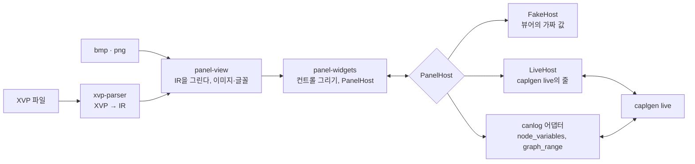

# XVP → egui 패널 설계서

작성일: 2026-10-14. 작성: `capl_to_rust`(`caplgen`)를 구현해 온 쪽.

앞 문서: [변환 검토서](xvp-to-egui-review.md), [개발 계획서](development-plan.md), [구현 검토 의견](implementation-review.md). 이 문서는 검토 의견에서 권한 방향으로 설계를 다시 적은 것이다. 단계와 완료 기준은 [구현 계획서](implementation-plan.md)에 있다.

## 목적과 범위

CANoe 패널 파일(`.xvp`)을 읽어 egui로 그리고, 그 컨트롤을 `caplgen`이 돌리는 CAPL 노드의 시스템 변수와 버스 신호에 잇는다. 쓰는 곳은 둘이다. 이 저장소의 뷰어(패널만 띄우는 앱)와 canlog GUI의 패널 창이다.

| 범위 안 | 범위 밖 |
| --- | --- |
| XVP 파싱과 중간 표현(IR) | CAPL 변환 (`capl_to_rust`의 일) |
| IR을 실행 중에 그리는 렌더러와 컨트롤 그리기 | ActiveX·.NET 사용자 컨트롤, DLL 패널 |
| 값 연결(`PanelHost`): 시스템 변수, 버스 신호, 환경 변수 | 서비스 신호·통신 객체(SOME/IP 등) |
| 뷰어, `caplgen live`에 직접 붙는 호스트 | CANoe 창(Trace, Graphics 등) |
| canlog에 넣는 방법(어댑터의 모양) | canlog 저장소 안의 구현 자체 |
| `caplgen live`에 더할 줄(제안) | |

## 설계 결정

앞의 두 문서와 다른 것은 D1, D2, D4다. 나머지는 그 문서들의 결정을 이어받았다.

| | 결정 | 이유 |
| --- | --- | --- |
| D1 | **패널은 실행 중에 IR에서 그린다.** Rust 코드 생성은 나중에 같은 IR에서 더한다 | 연 CFG와 패널이 어긋날 수 없다. 패널을 고쳐도 다시 빌드하지 않는다. `caplgen live`가 빌드 없이 도는 것과 짝이 맞는다 |
| D2 | **컨트롤은 자기 사각형 안에 직접 그린다.** egui에 맡기는 것은 글자 배치, 글자 입력, 팝업뿐이다 | XVP는 모든 컨트롤의 사각형을 픽셀로 준다. egui의 기본 위젯은 사각형을 채우지 않고 테마를 따른다. 직접 그리면 크기를 맞추는 일이 없어지고 XVP의 색이 그대로 쓰인다 |
| D3 | **값은 `PanelHost` 하나로 오간다.** 심볼은 패널을 열 때 한 번 풀어 번호로 쓴다 | 렌더러가 canlog도 `caplgen`도 모른다. 매 프레임 이름을 찾지 않는다 |
| D4 | **신호도 `caplgen live`의 줄로 읽고 쓸 수 있게 한다.** canlog는 자기 함수(`graph_range`)를 써도 된다 | 뷰어가 canlog 없이 끝까지 돈다. 값 테이블과 환산은 `caplgen`이 DBC에서 이미 갖고 있다 |
| D5 | IR은 정보를 버리지 않는다. 풀지 못한 속성은 원문으로 남긴다 | 포맷은 추정이다. 이해가 늘면 파서만 고친다 |
| D6 | 이미지는 패널을 열 때 풀어 텍스처로 올린다. 투명색은 그때 알파로 바꾼다 | 그리는 쪽은 디코더를 모른다. canlog GUI에는 `image`가 이미 있다 |
| D7 | XVP의 1픽셀은 egui의 1포인트다. 글꼴은 `pt × 96 / 72` | 화면 배율은 egui(`pixels_per_point`)가 맡는다 |
| D8 | Vector의 샘플과 그것에서 나온 그림은 저장소에 넣지 않는다 | Vector 소유다. 시험은 환경 변수로 폴더를 받는다 |

D2에는 대가가 있다. 버튼, 체크 박스, 슬라이더의 모양을 직접 그려야 한다. 그러나 이 모양들은 단순하고(사각형, 선, 글자), 계획서가 가장 손이 간다고 본 "위젯을 작은 사각형에 맞추는 일"이 통째로 없어진다. 목표는 Windows Forms와 픽셀까지 같은 그림이 아니라 같은 자리, 같은 크기, 같은 색이다.

## 전체 구조



| 크레이트 | 의존 | 하는 일 |
| --- | --- | --- |
| `xvp-parser` | XML 파서 | XVP → IR. 값 문법(좌표, 색, 글꼴, 심볼, 상태 값), 보고서. egui를 모른다 |
| `panel-widgets` | egui `=0.36.2` | 컨트롤 하나를 사각형에 그리는 함수들, `PanelHost`, `Value`. IR을 모른다 |
| `panel-view` | 위 둘, `image` | IR 트리를 돌며 컨트롤을 그린다. 심볼 풀기, 이미지 텍스처, 글꼴 등록, 비례 배치 |
| `xvp-viewer` | 위 셋, `eframe` | XVP를 여는 앱. `FakeHost`와 `LiveHost` |
| `xvp2egui` | `xvp-parser` | (나중) IR → Rust 소스. `panel-widgets`만 부르는 코드를 낸다 |

canlog에 들어가는 것은 앞의 셋이다(`engines/panel/`). `panel-widgets`를 IR에서 떼어 둔 것은 나중의 생성 코드가 IR 없이 그것만 쓰게 하기 위해서다.

## XVP 읽기

이 PC의 샘플 764개(내용이 다른 것)를 모두 읽어 얻은 것이다. 파싱 실패는 없었다.

### 구조

요소는 `Panel`, `Object`, `Property` 셋이다. 최상위 `Panel` 아래의 첫 `Object`가 패널 자신이고, 그 아래로 `Object`가 중첩된다. 컨트롤의 종류는 `Type`의 .NET 클래스 이름(마지막 마디)이다. 샘플에는 패널을 포함해 32종, (종류, 속성) 조합은 430개가 있다.

- `Object`의 속성: `Type`, `Name`, `ControlName`, 그리고 자식을 둘 수 있는 종류에는 `Children="Controls"`(자식이 없어도 붙는다).
- 자식 `Object`가 `Property`보다 먼저 온다.
- 기본값과 같은 속성은 저장되지 않는다.

### 값의 문법

| 값 | 꼴 | 예 |
| --- | --- | --- |
| 크기, 위치 | `정수, 정수` | `131, 47` |
| 색 | `R, G, B` 또는 .NET 색 이름(시스템 색 포함) | `221, 221, 221`, `Window`, `LightSteelBlue`, `Transparent` |
| 글꼴 | `이름, 크기pt[, style=...]` | `Microsoft Sans Serif, 8.25pt, style=Bold` |
| 불 | `True`, `False` | |
| 열거 | 이름 | `MiddleCenter`, `Vertical`, `FixedSingle`, `Hexadecimal` |
| 경로 | 패널 파일 기준 상대 경로, `\`와 `/` 둘 다 | `Bitmaps\ControlHeadLight.bmp` |

글꼴 크기에는 `7.20000029pt` 같은 값이 있다. 실수로 읽는다.

### 심볼 바인딩: `SymbolConfiguration`

세미콜론으로 나뉜 한 줄이다. 첫 필드가 형식 버전, 둘째가 종류다. 샘플에서 본 조합은 다음과 같다(많은 순).

| 버전 | 종류 | 필드 수 | 건수 | 예 |
| --- | --- | --- | --- | --- |
| 4 | 16 | 10 | 3,279 | `4;16;Engine;;;EngineSpeedEntry;2;;;-1` |
| 5 | 16 | 13 | 3,100 | `5;16;ICMPDemo;;;ModifyEchoPayload;1;;;-1;;;` |
| 6 | 16 | 14 | 874 | `6;16;DoorFL;;;LED_Color;1;;;-1;;;;` |
| 3 | 16 | 9 | 364 | `3;16;LightSystem;;;OnOff;1;;` |
| 4 | 2 | 10 | 226 | `4;2;FCMS;FCMS;Fuel_Pump_Contactor;Inner_2_Tank_Aft_Transfer_Pump;1;A429Ch4;;-1` |
| 1 | 2 | 6 | 192 | `1;2;easy;;MsgSine;Sine` |
| 5 | 128 | 13 | 109 | `5;128;GPS;;GPS1;Altitude;2;;;-1;;;` |
| 4 | 1 | 10 | 70 | `4;1;MessageBuilderEnvVars;;;evSrcAddr;1;;;-1` |
| 1 | 1 | 6 | 65 | `1;1;;;;evImageIndex` |
| 2 | 16 | 7 | 28 | `2;16;IO::IOCab1;;;AIN1;2` |

앞의 여섯 필드는 버전과 무관하게 같은 뜻으로 읽힌다.

| 필드 | 종류 16 (시스템 변수) | 종류 128 (구조체·배열 멤버) | 종류 2 (버스 신호) | 종류 1 (환경 변수) |
| --- | --- | --- | --- | --- |
| 2 | 네임스페이스 (`IO::IOCab1`처럼 겹칠 수 있다) | 네임스페이스 | 데이터베이스 이름 | (비었거나 데이터베이스) |
| 3 | | | 노드 (빌 수 있다) | |
| 4 | | 변수 | 메시지 | |
| 5 | 변수 | 멤버 (`Panel_Buttons[3]`처럼 색인이 붙을 수 있다) | 신호 | 변수 |
| 6 | 값의 형으로 보인다 (1 정수, 2 실수) | 같다 | 0 또는 1 | |
| 7 | | | 버스 이름 (`easy`, `CAN1`, `A429Ch4`) | |
| 9 | 대개 `-1`. `63`도 있다 | | | |

필드 6 이후의 뜻은 추정이다. 파서는 필드 2~5와 7을 이름으로 풀고, 줄 전체를 원문으로 함께 남긴다. `CompassControl`은 `SymbolConfiguration1`, `SymbolConfiguration2` 둘을 갖는다.

### 스위치의 상태와 비트맵

`SwitchControl`은 `StateCnt`(상태 수)와 `SwitchValues`(쓰는 값)를 늘 갖는다.

- `SwitchValues`: `1;2;0;1`. 버전, 상태 수, 상태마다의 값.
- `SwitchValuesRx`: 표시할 때 값을 상태에 대는 표. 값(`1;3;0;1;2`) 또는 범위(`1;9;[41..45];[36..40];…`).
- `SwitchValuesVT`, `SwitchValuesVTXml`: 값 테이블과의 대응. 줄 형식과 XML 형식이 있다.

비트맵은 상태의 그림을 가로로 이어 붙인 한 장이다. **조각 수는 `StateCnt + 1`이다.** 그림이 디스크에 있는 스위치 1,360개 가운데 1,308개에서 그렇게 나눈 조각의 가로세로 비가 컨트롤의 비에 더 가깝다. Easy 샘플의 세 장을 직접 보았다.

| 그림 | 크기 | 조각 (상태 2개) |
| --- | --- | --- |
| `ControlHeadLight.bmp` | 90×30 | 빈 단추, 꺼진 등, 켜진 등 |
| `ControlHazard.bmp` | 164×29 | 꺼짐, 꺼짐(같은 그림), 켜짐 |
| `ControlIgnition.bmp` | 105×34 | 꺼짐, 꺼짐(같은 그림), 켜짐 |

첫 조각은 상태에 들지 않는다. 값이 어느 상태에도 맞지 않거나 값이 없을 때의 그림으로 보인다(추정). 조각은 컨트롤의 크기로 늘여 그린다. `ControlHazard.bmp`는 조각 하나가 약 54.7×29인데 컨트롤은 34×30이다.

너비가 조각 수로 나누어떨어지지 않는 그림은 `i × 너비 / 조각 수`를 반올림한 자리에서 자른다. CANoe의 규칙은 확인하지 못했다.

투명색: `TransparentColor`가 있으면 그 색을 알파 0으로 바꾼다. 이 속성이 없는 스위치 1,156개 가운데 358개의 그림에 순수한 파랑(`0, 0, 255`)이 있고, 320개는 왼쪽 위 화소가 그 색이다. Easy의 세 장도 바탕이 파랑이다. **기본 투명색이 파랑**이라는 가설을 세우고 CANoe 화면으로 확인한다.

## 중간 표현 (IR)

```rust
pub struct Panel {
    pub file: PathBuf,
    pub serializer_version: Option<String>,
    pub root: Control,
    pub report: Report,          // 모르는 종류, 풀지 못한 속성, 없는 이미지
}

pub struct Control {
    pub kind: Kind,              // Known(ControlKind) | Unknown(String)
    pub name: String,            // XVP의 Name. 패널 조작 함수가 이 이름으로 부른다
    pub rect: Rect,              // 부모 기준. Location과 Size
    pub props: Props,            // 이름 → 원문. 푼 값은 접근 함수가 그때 만든다
    pub symbols: Vec<Symbol>,    // 대개 0개 또는 1개. Compass는 2개
    pub children: Vec<Control>,
}

pub enum Symbol {
    SysVar { namespace: String, name: String },
    SysVarMember { namespace: String, var: String, member: String },
    Signal { database: String, node: String, message: String, signal: String, bus: String },
    EnvVar { name: String },
    Other { kind: u32 },         // 서비스 신호, 통신 객체
}
```

`Props`는 원문을 그대로 들고, `props.color("BackColor")`, `props.font("Font")`, `props.int("Maximum")`처럼 읽을 때 푼다. 속성이 없으면 `None`이고, 기본값은 그리는 쪽이 정한다. 그래서 기본값 표는 그리는 코드가 읽는 속성에만 필요하다.

IR은 JSON으로 낼 수 있다(스냅샷 시험, 집계 도구).

## 값 연결

### `PanelHost`

```rust
pub enum Value { Int(i64), Float(f64), Text(String), Bytes(Vec<u8>), Ints(Vec<i64>), Floats(Vec<f64>) }

pub struct SymbolInfo {
    pub ty: ValueType,                    // 변수·신호의 형
    pub min: Option<f64>, pub max: Option<f64>,
    pub unit: Option<String>,
    pub labels: Vec<(i64, String)>,       // 값 테이블
    pub writable: bool,
}

pub trait PanelHost {
    /// 패널을 열 때 한 번. 호스트가 모르는 심볼은 None: 그 컨트롤은 비활성으로 그린다.
    fn resolve(&mut self, symbol: &SymbolName) -> Option<SymbolId>;
    fn info(&self, id: SymbolId) -> &SymbolInfo;
    /// 지금의 값. 아직 값이 없으면 None.
    fn read(&self, id: SymbolId) -> Option<&Value>;
    /// 이번 프레임에 쓸 값을 줄에 넣는다. 보내는 일은 호스트가 한다.
    fn write(&mut self, id: SymbolId, value: Value);
}
```

`SymbolName`은 호스트가 아는 이름이다. IR의 `Symbol`을 다음처럼 바꾼다.

| IR | `SymbolName` | 근거 |
| --- | --- | --- |
| `SysVar { Engine, EngineSpeedEntry }` | `SysVar("Engine::EngineSpeedEntry")` | `caplgen`과 canlog가 쓰는 이름 |
| `SysVarMember { GPS, GPS1, Altitude }` | `SysVar("GPS::GPS1.Altitude")` | `caplgen`은 구조체 변수를 멤버마다의 변수로 푼다 |
| `Signal { easy, Light, LightState, HeadLight, easy }` | `Signal { message: "LightState", signal: "HeadLight", bus: "easy" }` | `caplgen`의 신호 이름은 `메시지::신호`다. 버스는 채널을 고르는 데 쓴다 |
| `EnvVar { evImageIndex }` | `SysVar("evImageIndex")` | `caplgen`은 환경 변수를 네임스페이스 없는 변수로 묶는다(이름의 꼴은 확인이 필요하다) |

### 쓰기의 규칙

- **읽기 전용.** `ReadOnlyControl`이 켜진 컨트롤과 `info.writable`이 거짓인 심볼에는 쓰지 않는다.
- **스위치.** 누르면 다음 상태로 가고 그 상태의 `SwitchValues` 값을 쓴다. `IsButton`이면 누르는 동안만 둘째 상태다(둘 다 속성 이름에서 본 추정이다).
- **버튼.** 누를 때와 뗄 때 값을 따로 쓴다.
- **슬라이더.** 끄는 동안 값을 쓴다. `CommitValue`가 `OnlyLastValue`이면 놓을 때 한 번 쓴다(추정).
- **글자 입력.** Enter나 포커스를 잃을 때 쓴다. `SendOnFocusLost`가 `False`이면 Enter에만(추정).
- **형.** 쓰는 값은 `info.ty`에 맞춘다. 정수 변수에는 정수를 쓴다.

컨트롤은 쓴 값을 자기 것으로 기억하지 않는다. 다음 프레임에 `read`가 돌려주는 값을 그린다. 호스트가 값을 받아들이지 않으면 컨트롤은 원래 값으로 돌아간다. CANoe의 패널도 변수의 값을 보여 줄 뿐이다.

## `caplgen live`에 더할 줄 (제안)

`capl_to_rust` 쪽 변경이다. 지금의 줄(`rx`, `sysvar`, `key`, `stop` / `ready`, `tx`, `sysvar`, `write`, `stopped`)에 더한다.

| 방향 | 줄 | 뜻 |
| --- | --- | --- |
| 입력 | `{"signal": {"name": "LightState::HeadLight", "value": 1}}` | 신호를 쓴다(물리 값). `"raw": 1`이면 원시 값. 세션의 `signal` 입력과 같은 모양이고 호스트의 `inject_il_signal`로 간다 |
| 입력 | `{"watch": {"signals": ["EngineState::EngineSpeed", "EngineState::OnOff"]}}` | 이 신호들의 값을 알려 달라 |
| 출력 | `{"signal": {"t_ns": …, "name": "EngineState::EngineSpeed", "raw": 5001, "value": 2500.5}}` | 지켜보는 신호의 값이 버스의 프레임에서 바뀌었다. 노드가 보낸 프레임과 `rx`로 들어온 프레임 둘 다 본다 |
| 출력 | `ready.sysvars[]`에 `min`, `max`, `unit`, `labels` | 변수의 범위와 값 테이블 |
| 출력 | `ready.signals[]` (지켜볼 수 있는 신호의 이름, 범위, 값 테이블) | 콤보 박스의 항목과 심볼 표시 |
| 출력 | `{"panel": {"node": "N", "call": "enableControl", "panel": "Control", "control": "SwitchControl1", "args": [0]}}` | 노드가 패널 조작 함수를 불렀다. 지금은 stub이다. 나중 단계 |

- 쓴 신호가 버스에 나가는 것은 그 메시지를 보내는 노드가 `caplgen`에서 돌 때뿐이다. 다른 경우에 `live`는 `note`로 알린다.
- `watch`는 `caplgen`이 DBC의 정의로 프레임을 푸는 것이다. 환산과 값 테이블이 이미 거기 있다.
- canlog는 신호 읽기에 자기 함수 `graph_range`를 쓸 수도 있다. 그 함수는 호출마다 세션 저장소(SQLite)를 연다. 계기판처럼 자주 읽는 데는 `watch`가 가볍다. 어느 쪽을 쓸지는 canlog의 어댑터가 정한다.

## 그리기

### 배치

- **좌표.** 컨트롤의 사각형은 부모의 왼쪽 위에서 잰 `Location`과 `Size`다. 패널의 원점은 창의 내용 영역 왼쪽 위다.
- **순서.** Windows Forms에서는 `Controls`의 앞쪽이 위에 그려진다. 그래서 자식을 뒤에서부터 그린다(겹치는 컨트롤로 확인이 필요하다).
- **잘라 내기.** 자식은 부모의 사각형으로 잘린다(`Painter::with_clip_rect`).
- **비례.** 패널의 `IsProportional`이 켜져 있으면 창의 크기와 패널의 `Size`의 비로 모든 사각형을 늘린다. 꺼져 있으면 크기가 고정이다.
- **상호작용.** 컨트롤마다 `ui.interact(rect, id, sense)`로 입력을 받는다. `id`는 패널과 컨트롤의 경로로 만든다. 글자 입력만 `ui.put(rect, TextEdit)`을 쓴다.
- **보이기.** `IsVisibleByLoad`가 `False`이면 처음에 그리지 않는다. 패널 조작 함수가 바꿀 수 있다.

### 첫 범위의 컨트롤

Easy와 `CANSystemDemo`의 패널을 그리는 데 필요한 것이다. 읽는 속성은 샘플에서 본 것이다.

| 컨트롤 | 읽는 속성 | 그리기와 동작 |
| --- | --- | --- |
| Panel | `Size`, `BackColor`, `ImageFileName`, `IsProportional`, `BorderStyle` | 바탕색, 배경 그림 |
| StaticText | `Text`, `Font`, `ForeColor`, `BackColor`, `TextAlign`, `BorderStyle` | 정렬한 글자. `\n`은 줄 바꿈 |
| GroupBox | `Text`, `Font`, `ForeColor`, `BackColor` | 테두리와, 테두리에 걸친 제목 |
| PictureBox | `ImageFile`, `TransparentColor`, `IsProportional`, `BorderStyle` | 그림 |
| Switch | `StateCnt`, `SwitchValues`, `SwitchValuesRx`, `ImageFile`, `TransparentColor`, `IsButton`, `ReadOnlyControl`, `Activation` | 값에 맞는 조각. 누르면 다음 상태 |
| TrackBar | `Minimum`·`Maximum`과 `…Double`, `TickFrequency`, `TickStyle`, `DisplayMinMax`, `DisplayValue`, `Orientation`, `SmallChange`, `LargeChange`, `CommitValue`, `BackColor`, `ReadOnlyControl` | 홈, 손잡이, 눈금, 최소·최대와 값의 글자 |
| TextBox | `ValueDisplay`, `ValueDecimalPlaces`, `LeadingZeros`, `DisplayLabel`, `DescriptionText`, `DescriptionSize`, `BoxFont`·`BoxBackColor`·`BoxForeColor`·`BoxTextAlign`·`BoxBorderStyle`, `Text…`, `Alarm…`, `UsedValueTable`, `ReadOnlyControl` | 설명 라벨과 값 상자. 형식에 맞춘 글자, 경보 색, 입력 |
| AnalogGauge | `ScaleMin`·`ScaleMax`, `ScaleAngle`, `MainTicksNumber`, `LengthMainTicks`, `ArrowColor`·`ArrowWidth`, `CenterColor`·`CenterRadius`, `Min`·`Mid`·`MaxColor`, `Lower`·`UpperRangeLimit`, `LegendText`, `GaugeFont`, `BackgroundColor`, `TicksColor` | 호, 눈금, 색 구간, 바늘 |
| LED, Button, ProgressBar, Clock, Meter, ComboBox | (`CANSystemDemo`에 있다) | 구현 계획서의 둘째 묶음 |

텍스트 박스의 `ValueDisplay`는 샘플에서 여섯 가지다: `Decimal` 1,288, `Double` 542, `Text` 405, `Symbolic` 251, `Hexadecimal` 242, `Binary` 3. `Symbolic`은 값 테이블의 글자를 보여 준다(`info.labels`).

`TrackBar`는 정수 속성(`Maximum`)과 실수 속성(`MaximumDouble`)을 함께 갖는다. 실수 쪽이 있으면 그것을 쓴다.

### 글꼴과 색

- **글꼴.** 패널이 이름으로 부르는 글꼴을 Windows 글꼴 폴더에서 읽어 `FontFamily::Name`으로 등록한다(`Context::add_font`). 샘플에서 가장 많은 것은 Microsoft Sans Serif(`micross.ttf`)와 Arial(`arial.ttf`)이다. 파일이 없으면 egui의 기본 글꼴로 그린다. 굵은 글꼴은 굵은 파일(`arialbd.ttf`)이 있으면 그것을, 없으면 보통 글꼴을 쓴다.
- **색.** .NET의 이름 있는 색은 표로 바꾼다. 시스템 색(`Window`, `Control`, `Info`, `WindowText`, `ControlText`)은 Windows의 기본 테마 값으로 고정한다. 패널은 canlog의 밝고 어두운 테마를 따르지 않는다.
- **비활성.** 호스트가 심볼을 모르거나 값이 없으면 컨트롤을 흐리게 그리고 입력을 받지 않는다. 까닭은 마우스를 올리면 보인다.

## 호스트

| 호스트 | 읽기 | 쓰기 | 쓰는 곳 |
| --- | --- | --- | --- |
| `FakeHost` | 메모리의 표. 옆 창에서 값을 넣는다 | 쓴 값을 목록으로 보여 주고 표에 넣는다 | 뷰어, 시험 |
| `LiveHost` | `caplgen live`의 `sysvar`·`signal` 줄을 받아 표에 둔다 | `sysvar`·`signal` 줄을 쓴다 | 뷰어. canlog 없이 끝까지 돈다 |
| canlog 어댑터 | `node_variables`(변수), `graph_range` 또는 `watch`(신호) | `set_node_variable`, 신호 쓰기 | canlog |

`LiveHost`는 `caplgen live <구성>`을 띄우고 `ready`를 기다려 변수와 신호의 목록으로 심볼을 푼다. 버스가 없으므로 노드가 보낸 프레임(`tx`)은 버리거나 보여 주기만 한다. 프레임을 다시 넣지 않아도 노드끼리는 `caplgen`의 호스트 안에서 주고받는다.

## canlog에 넣는 방법

canlog 저장소의 일이고, 여기에는 모양만 적는다.

- `engines/panel/`에 `xvp-parser`, `panel-widgets`, `panel-view`를 복사하고 `manifest.json`에 출처 커밋과 해시를 적는다(canlog의 엔진 규칙).
- `gui/egui`에 `panels` 선택 기능을 둔다. 끄면 canlog는 지금과 같다.
- **패널 목록은 CFG에서 온다.** canlog의 CFG 엔진(`cfg_core`의 `tdp.rs`)이 CFG의 패널과 XVP 경로를 이미 읽는다. CFG를 열면 그 목록이 View 메뉴에 나오고, 고르면 그 XVP를 읽어 창으로 띄운다.
- 패널 창은 `files/nodes.rs`의 Node variables 창과 같은 모양의 별도 파일에 둔다. `ui.rs`에는 호출만 더한다.
- 어댑터가 `PanelHost`를 구현한다. 열린 패널이 있을 때만 값을 자주 읽는다.
- CAPL 노드가 도는 세션이 없으면 어댑터는 어떤 심볼도 풀지 못하고, 패널은 비활성으로 그려진다.

## 시험

| 대상 | 방법 |
| --- | --- |
| 값 문법 | 색, 글꼴, 심볼, 상태 값의 단위 시험. 샘플에서 뽑은 꼴을 쓴다(값은 지어낸 것으로) |
| 파서 | 저장소 안의 지어낸 XVP로 IR 스냅샷. 샘플 폴더가 있으면 764개를 돌려 실패가 없고 모르는 것의 목록이 늘지 않는지 본다 |
| 그리기 | `egui_kittest`로 패널을 그려 도형과 그림을 본다. 기준 그림이 Vector 샘플의 것이면 저장소 밖에 둔다 |
| 동작 | `FakeHost`에 값을 넣고 그린 상태를 본다. 컨트롤을 누르고 쓴 값의 목록을 본다 |
| `LiveHost` | 지어낸 구성 설명과 지어낸 XVP로 `caplgen live`를 띄운다. 스위치를 누르면 노드가 프레임을 보내고 그 신호가 패널에 돌아온다 |
| canlog 안 | canlog의 시험 규칙을 따른다 |

## 확인이 필요한 것

모두 CANoe 화면이나 CANoe에서 저장한 파일로 확인하는 것이다.

1. 스위치 비트맵의 첫 조각은 언제 그려지는가.
2. `TransparentColor`가 없을 때의 투명색(가설: 파랑).
3. 너비가 조각 수로 나누어떨어지지 않을 때 자르는 자리.
4. 겹친 컨트롤이 그려지는 순서.
5. `SymbolConfiguration`의 필드 6 이후, 특히 필드 9의 `63`.
6. 저장되지 않은 속성의 기본값(그리는 코드가 읽는 것부터).
7. 환경 변수가 `caplgen`의 변수 목록에 나오는 이름.
8. 그룹 박스 안 자식의 원점(상자의 왼쪽 위로 보았다).
9. 스위치(`IsButton`, 여러 상태의 순환), 슬라이더(`CommitValue`), 글자 입력(`SendOnFocusLost`)이 값을 쓰는 때.

## 근거

- XVP: `C:\Users\Public\Documents\Vector` 아래 CANoe·CANalyzer 13.0 샘플 1,523개, 내용이 다른 764개. 종류·속성·심볼의 개수는 그 764개를 세었다. 스위치 그림의 수치는 그림이 디스크에 있는 1,360개에서 나왔다.
- Easy 샘플의 `Control.xvp`를 전부 읽었고, `Bitmaps`의 스위치 그림 세 장을 열어 보았다.
- egui 0.36.2 소스에서 확인한 것: `Ui::place`, `Ui::put`, `Ui::scope_builder`, `Ui::interact`, `Ui::allocate_rect`, `Ui::painter_at`, `UiBuilder::max_rect`, `Painter::{image, text, rect_filled, rect_stroke, line_segment, circle_filled, with_clip_rect}`, `Context::{load_texture, add_font, request_repaint_after}`, `ColorImage::from_rgba_unmultiplied`, `FontFamily::Name`. `egui_kittest` 0.36.2에는 `snapshot`과 `wgpu` 기능이 있다.
- canlog(`najari/codex_test`, `e2cf5db`): `gui/core/src/backend.rs`(`node_variables`, `set_node_variable`, `graph_range`), `src/transport/nodes.rs`(`caplgen live`와 주고받는 줄, 쓸 수 있는 변수의 형), `gui/egui/Cargo.toml`.
- capl_to_rust(`najari/capl_to_rust`, `bddd126`): `apps/caplgen/src/live.rs`, `crates/capl-rt/src/host.rs`(`inject_il_signal`), `crates/capl-session/src/lib.rs`(`signal` 입력), `crates/capl-model/src/sysvars.rs`.
- 이 문서의 구조와 줄은 설계다. 아직 구현된 것은 없다.
