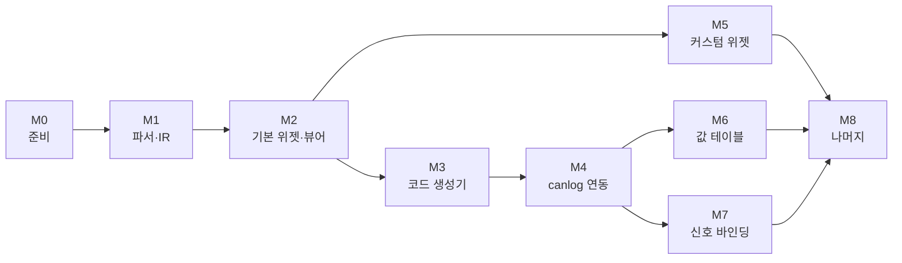

# panel_to_rust_egui 개발 계획서

작성일: 2026-10-14. 같은 날 재검토해 고쳤다. 근거: [변환 검토서](xvp-to-egui-review.md).

## 목적과 범위

CANoe 패널 파일(`.xvp`)을 egui 위젯 코드로 바꾸고, 그 결과를 canlog GUI(`canlog-gui-egui`)에 선택 기능으로 컴파일해 넣는다. 패널은 canlog가 CAPL 노드를 돌리는 온라인 세션에서 시스템 변수를 읽고 쓴다.

| 범위 안 | 범위 밖 |
| --- | --- |
| XVP 파싱과 중간 표현(IR) | CAPL 변환 (capl_to_rust의 일) |
| egui 위젯 라이브러리 (기본 13종, 커스텀 9종) | ActiveX·.NET 사용자 컨트롤, DLL로 구현된 패널 |
| XVP를 바로 그리는 검증용 뷰어 | CANoe 창 (Trace, Graphics 등) |
| IR → Rust 코드 생성기 | 서비스 신호·통신 객체(SOME/IP 등) 바인딩 |
| canlog 어댑터와 `panels` 기능 | 로그 재생에서 쓰는 읽기 전용 패널 (검토서 미결 7번, 정해지면 더한다) |
| 신호 바인딩 (canlog·caplgen 변경 요청 포함) | |

기간은 산정하지 않았다. 작업량은 단계의 순서와 완료 기준으로 관리한다. 단계 표의 규모(S·M·L)는 상대 비교용 추정이다.

## 전제와 가정

확정된 것은 egui 0.36.2(canlog가 고정한 버전)와 canlog에 컴파일해 붙이는 방식이다. 아래 네 가지는 아직 정해지지 않았고, 이 계획은 표의 가정으로 짰다. 바뀌면 영향을 받는 단계를 다시 본다.

| 미결 사항 | 계획의 가정 | 바뀌면 |
| --- | --- | --- |
| 패널 묶음이 하나로 고정인가 | 고정 (컴파일해 넣음) | CFG마다 달라지면 canlog가 XVP를 실행 중에 읽는 방식을 M8에 더한다. 파서와 위젯은 공유한다 |
| 생성 코드를 두는 곳 | canlog 밖의 폴더. canlog 안의 빈 패널 크레이트가 환경 변수로 받는다 | canlog 저장소에 넣으면 M4의 빌드 구성이 단순해지고 `.gitignore`가 바뀐다 |
| 신호 바인딩 쓰기 | 읽기를 먼저, 쓰기는 M7 | 읽기만 필요하면 M7의 쓰기 항목과 다른 저장소 요청이 빠진다 |
| 화면 일치 수준 | 배치와 동작은 동일, 위젯 모양은 egui 스타일 | 픽셀 일치가 목표면 기본 위젯도 직접 그려야 해서 M2가 커진다 |

실제로 변환할 패널(CFG와 패널 폴더)은 아직 받지 못했다. 받으면 M1에서 같은 집계를 돌려 M5 이후의 우선순위를 정한다.

## 저장소 구성

```text
panel_to_rust_egui/
  Cargo.toml                 워크스페이스. edition 2021, rust-version 1.95 (canlog GUI와 같음)
  crates/
    xvp-parser/              XML → IR. egui에 의존하지 않는다
    panel-widgets/           egui 위젯, PanelHost 트레이트. canlog에 복사되는 크레이트
    xvp-viewer/              XVP를 컴파일 없이 그리는 앱 (가짜 값 호스트)
    xvp2egui/                IR → Rust 소스 생성기 (CLI). 이미지 변환 포함
  tests/                     샘플 순회, IR 스냅샷, 생성 코드 빌드 시험
  docs/
```

- **샘플은 저장소에 넣지 않는다.** Vector 샘플의 XVP와 비트맵은 Vector 소유다. 시험은 환경 변수(이름은 예시: `XVP_CORPUS`)로 폴더를 받고, 없으면 `skipped`를 출력하고 넘어간다. canlog가 `caplgen.exe` 없을 때 시험을 건너뛰는 방식과 같다.
- **샘플은 내용으로 중복을 뺀다.** 검토한 PC에서 찾은 1,526개 중 내용이 다른 파일은 764개였다. 시험과 집계는 파일 해시로 중복을 걸러 낸다.
- **`panel-widgets`는 egui 외에 의존하지 않는다.** canlog는 이 크레이트를 `engines/panel/`에 복사하고 `manifest.json`에 출처 커밋과 해시를 적는다. egui는 `=0.36.2`로 고정한다. 이미지 디코더는 변환 툴 쪽에만 둔다.
- **`xvp-parser`는 egui를 모른다.** 뷰어, 생성기, 시험이 같은 IR을 쓴다.

## 단계

| 단계 | 목표 | 규모 | 선행 |
| --- | --- | --- | --- |
| M0 | 준비 | S | |
| M1 | 파서와 IR | M | M0 |
| M2 | 기본 위젯과 뷰어 | L | M1 |
| M3 | 코드 생성기 | M | M2 |
| M4 | canlog 연동 (시스템 변수) | L | M3, 미결 1·2번 |
| M5 | 커스텀 위젯 | L | M2 |
| M6 | 시스템 변수의 값 테이블 | S | M4 |
| M7 | 신호 바인딩 | M (읽기), L (쓰기 포함) | M4 |
| M8 | 나머지 | M | M5~M7 |



화살표는 선행 관계다. M5는 뷰어로 확인할 수 있어서 canlog 연동(M3, M4)과 나란히 진행할 수 있다. M7의 쓰기는 canlog와 caplgen 저장소의 변경이 필요하므로 요청은 M4보다 앞서 낸다(아래 "다른 저장소에 요청할 변경").

### M0. 준비

- 워크스페이스와 크레이트 뼈대를 만든다. canlog와 같은 `edition`, `rust-version`을 쓴다.
- 샘플 순회 시험의 틀을 만든다. 폴더를 재귀로 돌며 `*.xvp`를 모으고 해시로 중복을 뺀다. 폴더가 없으면 건너뛴다.
- CI를 만든다. 형식 검사, 빌드, 시험을 돌린다. 샘플이 없는 환경이므로 샘플 시험은 건너뛰어도 통과해야 한다.

완료 기준: `cargo test`가 샘플이 있는 PC와 없는 PC에서 모두 통과한다.

### M1. 파서와 IR

IR은 정보를 버리지 않는다. 해석하지 못한 속성은 원문 문자열로 남긴다.

- **트리.** `Panel`, `Object`, `Property`를 읽어 컨트롤 트리를 만든다. 컨트롤 종류는 `Type`의 클래스 이름으로 구분한다.
- **기본값 표.** XVP는 기본값과 같은 속성을 저장하지 않으므로 빠진 값은 샘플에서 알 수 없다. 설치된 Panel Designer(CANoe 13.0)에서 컨트롤 클래스의 속성 기본값을 읽어 표로 만든다. `TrackBarControl`과 `ButtonControl` 두 종에서 읽히는 것을 확인했다. XVP의 속성 이름과 클래스의 속성 이름이 다른 경우의 대응표도 함께 만든다. 표를 저장소에 싣기 전에 라이선스 조건을 확인한다.
- **속성 범위.** 샘플에서 관찰한 (종류, 속성) 조합은 430개다. 이것이 파서가 다뤄야 할 최소 범위다.
- **값 파서.** 좌표·크기(`131, 47`), 색(`221, 221, 221`과 .NET 색 이름), 글꼴(`Arial, 10pt, style=Bold`), 정렬(`MiddleCenter` 등).
- **심볼 바인딩.** `SymbolConfiguration`을 종류(시스템 변수, 버스 신호, 구조체 멤버, 환경 변수, 서비스·통신 객체)로 나눠 읽는다. 필드 수가 6~14개로 다르므로 버전 필드로 갈라 읽는다. 이름 경로 밖의 필드는 원문으로 보존한다. `CompassControl`은 이 속성을 두 개 갖는다.
- **상태 값.** `SwitchValues`, `SwitchValuesRx`, `SwitchValuesVT`의 세 형식(`<Version>2</Version>…` XML 형식 포함)을 읽는다.
- **보고서.** 모르는 컨트롤, 모르는 속성, 없는 이미지를 모아 보고서로 낸다. 오류로 멈추지 않는다.

완료 기준:

- 샘플 764개(중복 제외)가 모두 IR이 된다.
- 관찰한 (종류, 속성) 430개가 모두 "처리함" 또는 "무시함, 사유"로 분류되어 있다.
- 샘플에 나온 컨트롤 31종의 기본값 표가 있다.
- 대표 패널 약 10개의 IR이 JSON 스냅샷으로 저장되어 있고, 파서를 고치면 차이가 시험에서 보인다.
- 집계 도구가 컨트롤 종류별·바인딩 종류별 개수를 낸다. 실제 변환 대상 패널에 같은 도구를 돌릴 수 있다.

### M2. 기본 위젯과 뷰어

`PanelHost` 트레이트(심볼 이름으로 값을 읽고 쓰는 두 동작)를 먼저 정한다. 위젯은 이것만 알고 canlog를 모른다.

| 위젯 | 대응 컨트롤 | egui에 없어 직접 그리는 부분 |
| --- | --- | --- |
| 라벨 | StaticTextControl | |
| 그룹 박스 | GroupBoxControl | 테두리에 걸치는 제목 |
| 텍스트 박스 | TextBoxControl | 설명 라벨, 표시 형식(10진, 16진, 이진, 심볼), 경보 색 |
| 버튼 | ButtonControl | 누를 때·뗄 때 값 |
| 체크 박스, 라디오 버튼 | CheckBoxControl, RadioButtonControl | |
| 슬라이더 | TrackBarControl | 눈금, 최소·최대 표시 |
| 이미지 | PictureBoxControl | |
| 콤보 박스 | ComboBoxControl | 항목은 값 테이블에서 온다(M6, M7 전까지 비워 둠) |
| 진행 막대 | ProgressBarControl | 세로 방향, 기준값 |
| 탭 | VectorTabControl, VectorTabPage | |
| 숫자 입력 | NumericUpDownControl | |

- **배치.** `ui.place(rect, widget)`으로 절대 좌표에 놓는다. 컨테이너는 `ui.scope_builder`로 자식 영역을 만든다. 패널의 `IsProportional`이 켜진 경우에만 창 크기에 맞춰 늘린다.
- **크기 맞춤.** egui 위젯은 지정한 사각형을 그대로 채우지 않고 가운데에 놓이며, 최소 크기가 더 크면 넘친다. 위젯마다 여백과 최소 크기를 XVP의 크기에 맞게 조정한다. 이 단계에서 가장 손이 많이 가는 부분이다.
- **글꼴.** pt를 px로 바꾼다. egui 기본 글꼴은 Ubuntu Light라 그대로 두면 글자 폭이 달라진다. Windows 글꼴 폴더에서 `micross.ttf`와 `arial.ttf`를 읽어 패널 전용 글꼴로 등록한다. canlog가 맑은 고딕을 읽는 방식과 같다. 파일이 없으면 기본 글꼴로 그린다.
- **이미지.** 위젯은 이미 풀린 픽셀 데이터를 받는다. bmp, png, jpg, gif 읽기와 `TransparentColor`를 알파로 바꾸는 일은 변환 툴 쪽(뷰어, 생성기)에서 한다. 없는 파일은 빈 자리 표시로 그리고 보고서에 기록한다.
- **뷰어.** XVP를 열어 바로 그린다. 가짜 값 호스트에 값을 넣고 조작하는 창을 둔다. 읽기 전용 컨트롤은 값을 쓰지 않는다.

완료 기준: Easy 샘플의 Control·Display 패널이 CANoe 화면과 같은 배치로 뜨고, 컨트롤을 조작하면 가짜 값 호스트의 쓰기 목록에 값이 들어간다. 비교용 CANoe 화면 캡처는 이 단계 시작 전에 준비한다.

### M3. 코드 생성기

- **출력.** 패널마다 Rust 모듈 하나, 패널 목록, 풀어 놓은 이미지 데이터. 컨트롤 이름을 식별자로 쓰고 좌표와 범위는 숫자 그대로 적는다.
- **원본 정보.** 생성 코드에 원본 XVP의 해시와 필요한 심볼 목록을 적는다. canlog가 연 CFG와 패널이 어긋났는지 확인하는 데 쓴다.
- **덮어쓰기.** 생성 파일과 사용자가 쓰는 파일을 분리한다. 다시 생성해도 손으로 쓴 코드는 지워지지 않는다.
- **시스템 변수 이름.** XVP는 네임스페이스와 이름을 따로 저장한다. canlog 형식(`네임스페이스::이름`)으로 합쳐서 적는다.

완료 기준:

- 기본 위젯만 쓰는 패널은 생성 코드가 수정 없이 빌드된다.
- 같은 패널을 뷰어로 그린 것과 생성 코드로 그린 것이 같다. 비교는 egui가 내는 도형 목록으로 한다. canlog의 `egui_kittest` 구성에는 화면 이미지 비교가 없다.
- 시험에 "생성 코드를 빌드한다"가 들어 있고, 빌드되지 않는 코드가 나오면 실패한다.

### M4. canlog 연동 (시스템 변수)

canlog 저장소(`najari/codex_test`)에서 하는 작업이다. 변경을 작게 유지하기 위해 `files/ui.rs`에는 호출만 더하고 나머지는 별도 파일에 둔다.

- `engines/panel/`에 `panel-widgets`를 복사하고 `manifest.json`에 출처 커밋과 해시를 적는다.
- canlog 안에 빈 패널 크레이트를 만든다. 빌드 스크립트가 환경 변수로 받은 폴더의 생성 코드를 포함하고, 변수가 없으면 패널 0개로 빌드된다. 생성 코드 폴더를 경로 의존성으로 직접 걸면 폴더가 없을 때 기능을 꺼도 빌드가 실패한다. 두 동작 모두 작은 크레이트로 시험해 확인했다.
- `gui/egui`에 `panels` 선택 기능을 더하고 `scripts/build.ps1`에 스위치를 더한다. 패널이 실제로 동작하려면 `-Cfg -Vector` 빌드와 `caplgen.exe`가 함께 필요하다.
- 패널 어댑터를 만든다. `PanelHost`를 canlog 백엔드의 `node_variables`(읽기)와 `set_node_variable`(쓰기)로 구현한다. 쓰기는 작업 스레드에서 부른다.
- View 메뉴에 패널 창을 더한다. 패널은 크기가 고정이므로 떠 있는 창으로 먼저 넣는다.
- CAPL 노드가 도는 세션이 없으면 `This session runs no CAPL nodes` 오류가 나므로 패널을 비활성으로 표시한다.
- 읽는 주기를 정한다. `node_variables`는 canlog 메모리의 값을 읽으므로 자주 불러도 다른 프로세스를 기다리지 않는다. Node variables 창의 0.3초는 창이 고른 주기다. 다만 값이 바뀐 호출은 변수 전체를 복사하므로 변수가 많은 CFG에서 비용을 잰다. 열려 있는 패널이 있을 때만 자주 읽는다.
- 세션에 없는 변수에 묶인 컨트롤은 비활성으로 표시한다.

완료 기준:

- CAPL 노드가 도는 온라인 세션에서 패널 버튼이 시스템 변수를 쓰고, 노드가 프레임을 보낸다. canlog의 `tests/vector_capl_nodes.rs`와 같은 시나리오(가상 채널)로 시험한다.
- 환경 변수 없이 빌드한 canlog가 지금과 같다. `panels` 기능을 켠 빌드와 끈 빌드를 모두 시험한다.

### M5. 커스텀 위젯

`Painter`로 직접 그리는 위젯이다. M2의 뷰어로 확인할 수 있어서 M4와 나란히 진행해도 된다.

| 위젯 | 대응 컨트롤 | 개수 | 확인할 것 |
| --- | --- | --- | --- |
| 비트맵 스위치 | SwitchControl | 1,530 | 이미지 조각 규칙 |
| LED | LEDControl | 163 | 원, 사각형, 삼각형, 켜짐·꺼짐 색 |
| 헥스 편집기 | HexEditorControl | 82 | 열 수, 필드·텍스트 보기 |
| 바늘 계기 | MeterControl | 50 | 배경 이미지 위에 바늘만 그리는지(추정), 각도 범위와 바늘 모양 |
| 7세그먼트 | LCDControl, ClockControl | 42 | 정수·소수 자릿수 |
| 아날로그 계기판 | AnalogGaugeControl | 28 | 눈금, 색 구간(`CriticalProps`) |
| 기타 | LEDBand, CompassControl | 10 | |

스위치가 가장 많으므로 먼저 한다. 조각 수는 `StateCnt + 1`로 본다. 디스크에 이미지가 있는 스위치 1,360개 중 1,307개(96%)에서 그렇게 나눈 조각의 가로세로 비가 컨트롤의 비와 더 가깝다. CANoe에서 확인할 것은 두 가지다. 첫 조각의 쓰임(정의되지 않은 값일 때 그리는 것으로 추정)과, 너비가 조각 수로 나누어떨어지지 않는 96개의 반올림 방식이다. `StateCnt`로 나눈 쪽이 더 가까운 35개는 따로 열어 본다.

완료 기준: CANMainDemo의 Dashboard 패널이 가짜 값으로 움직인다.

### M6. 시스템 변수의 값 테이블

- 콤보 박스 항목과 심볼 표시값은 XVP에 없다. 신호의 값 테이블은 canlog가 실행 중에 돌려주므로(M7) 여기서는 시스템 변수의 것만 다룬다.
- 시스템 변수의 값 테이블은 변환 시점에 시스템 변수 정의에서 읽어 생성 코드에 넣는다. canlog의 CFG 엔진(`cfg_core`의 `sysvar.rs`)이 읽어 줄 수 있는지 먼저 확인한다. 안 되면 변환기에 읽기를 직접 구현한다.

완료 기준: 시스템 변수에 묶인 콤보 박스의 항목과 심볼 표시가 CANoe와 같다.

### M7. 신호 바인딩

읽기와 쓰기의 크기가 다르다. 읽기는 canlog에 있는 함수로 되고, 쓰기는 두 저장소에 통로를 내야 한다.

| 방향 | 하는 일 | 변경할 저장소 |
| --- | --- | --- |
| 읽기 | 패널 어댑터가 `graph_range`로 신호의 마지막 값을 읽는다. 이 함수는 신호마다 마지막 값, 원시 값, 값 테이블 글자, 범위를 돌려주고 한 번에 256개까지 받는다 | canlog (어댑터만) |
| 이름 | XVP의 (DB, 노드, 메시지, 신호, 채널)을 canlog의 신호 키(`채널:…:ID:…`, 이름·채널·CAN ID로 찾음)로 바꾸는 규칙 | 변환 툴 |
| 쓰기 | `caplgen live`가 받는 줄에 신호 쓰기를 더하고 Interaction Layer의 값 설정에 연결한다. canlog는 그 줄을 보낸다 | capl_to_rust, canlog |

- **읽기의 지연을 잰다.** `graph_range`는 세션 저장소에서 읽는다. 버스의 값이 저장소에 들어가기까지의 지연과 호출 비용을 측정한다. 계기판에 부족하면 그때 가벼운 조회 함수를 canlog에 요청한다.
- **쓰기는 통로만 낸다.** `caplgen`은 CAPL의 `$Msg::Sig = v`를 Interaction Layer 설정으로 변환한다. 송신 로직을 새로 짜지 않는다.
- **쓰기의 한계.** 쓴 신호는 그 메시지를 보내는 노드가 `caplgen`에서 돌 때만 버스에 나간다. 실제 ECU가 보내는 신호는 표시만 한다.
- 쓰기가 필요 없으면 쓰기 항목을 뺀다.

완료 기준:

- 신호에 묶인 계기판이 가상 채널의 버스 값을 따라 움직이고, 신호에 묶인 콤보 박스에 값 테이블의 항목이 나온다.
- (쓰기를 하는 경우) 신호에 묶인 버튼이 값을 쓰면 노드가 보낸 프레임이 가상 채널에 관측된다.

### M8. 나머지

- 구조체·배열 시스템 변수의 멤버(샘플의 2%), 환경 변수(2%). `caplgen`은 둘 다 다루지만 canlog와 주고받는 줄에 환경 변수가 없고, canlog는 정수·실수·문자열 변수만 쓴다. 통로가 필요한지 먼저 확인한다.
- CANoe 의존 컨트롤의 대체 동작: PanelButton(앱 안의 창 전환), PanelHelp(파일 열기), CAPLOutputView(노드의 `write()` 출력, canlog는 최근 200줄을 보관), Path(파일 선택 대화상자), StartStop 등.
- CAPL의 패널 조작 함수(`enableControl`, `putValueToControl` 등). 패널에 컨트롤 이름으로 접근하는 API를 두고, capl_to_rust가 그 호출을 내보내게 하는 일은 capl_to_rust 쪽 작업이다.
- 미결 1번이 "CFG마다 다름"으로 정해지면 실행 중에 XVP를 읽어 그리는 방식을 더한다. 파서와 위젯은 공유한다.

## 다른 저장소에 요청할 변경

| 저장소 | 변경 | 필요한 단계 |
| --- | --- | --- |
| canlog | `engines/panel/`, 빈 패널 크레이트, `panels` 기능, 패널 어댑터, View 메뉴, `build.ps1` 스위치 | M4 |
| canlog | `caplgen live`의 신호 쓰기를 보내는 함수 | M7 (쓰기) |
| capl_to_rust | `caplgen live`가 받는 신호 쓰기 줄 (Interaction Layer 연결) | M7 (쓰기) |
| canlog | 신호 값의 가벼운 조회 함수. 측정에서 `graph_range`가 부족할 때만 | M7 (읽기) |
| capl_to_rust | 패널 조작 함수 지원 | M8 |

쓰기 요청은 M2가 끝날 즈음 낸다. 변경이 두 저장소에 걸치므로, 그 시점에 신호 식별자 형식과 쓰기 줄의 모양을 먼저 합의한다.

## 시험 전략

| 대상 | 방법 |
| --- | --- |
| 파서 | 샘플 전체(중복 제외)를 돌려 IR 스냅샷을 비교한다. 모르는 속성 목록이 줄어드는지 추적한다 |
| 값 파서 | 색, 글꼴, 심볼 문자열, 상태 값의 단위 시험. 샘플에서 뽑은 실제 문자열을 쓴다 |
| 화면 | 대표 패널을 정해 CANoe 화면 캡처와 렌더링 결과를 나란히 비교한다 |
| 위젯 동작 | 가짜 값 호스트에 값을 넣고 컨트롤 상태를 확인한다. 반대로 조작하고 쓰기 목록을 확인한다. canlog와 같은 `egui_kittest`(`=0.36.2`)를 쓴다 |
| 코드 생성 | 생성 코드를 빌드한다. 뷰어와 같은 도형 목록을 내는지 비교한다 |
| canlog 안 | 환경 변수 없는 빌드, `panels` 기능을 켠 빌드와 끈 빌드를 시험한다. 가상 채널의 CAPL 노드로 쓰기와 프레임 송신을 확인한다 |

화면 비교용 캡처 기준은 M2 시작 전에 정한다. CANoe 13.0이 설치된 PC에서 직접 찍을 수 있다.

## 위험과 대응

자세한 표는 [검토서](xvp-to-egui-review.md#리스크와-한계)에 있다. 계획에 영향을 주는 것만 뽑는다.

| 위험 | 영향 단계 | 대응 |
| --- | --- | --- |
| egui 위젯이 XVP의 작은 사각형에 맞지 않는다 | M2 | 위젯마다 여백과 최소 크기를 조정한다. 화면 비교로 넘침을 걸러 낸다 |
| 기본값을 CANoe 13.0 설치본에서만 확인했다 | M1 | 다른 버전에서 저장한 패널을 받으면 그 버전의 기본값과 같은지 확인한다 |
| 포맷 문서가 없어 `SymbolConfiguration`과 상태 값의 의미가 추정이다 | M1, M5, M7 | 모르는 필드는 원문으로 보존한다. CANoe에서 값을 바꿔 저장해 차이를 확인한다 |
| 실제 변환 대상 패널을 아직 받지 못했다 | M5 이후 | 받는 즉시 M1의 집계를 돌려 우선순위를 다시 정한다 |
| 신호 쓰기가 두 저장소에 걸친다 | M7 | 읽기와 쓰기를 나눈다. 요청을 일찍 내고 식별자 형식을 먼저 합의한다 |
| 신호 값이 세션 저장소를 거쳐 늦게 보인다 | M7 | 지연을 측정한다. 부족하면 가벼운 조회 함수를 요청한다 |
| egui 버전이 올라가면 위젯 라이브러리도 같이 올려야 한다 | M2 이후 | 생성 코드는 egui를 직접 부르지 않고 `panel-widgets`만 부른다 |

## 바로 시작할 작업

- [ ] 워크스페이스와 크레이트 뼈대 (M0)
- [ ] 샘플 순회 시험 틀(해시로 중복 제거), CI (M0)
- [ ] 컨트롤 트리 파서 (M1)
- [ ] 설치된 Panel Designer에서 기본값 표와 속성 이름 대응표 뽑기 (M1)
- [ ] 색, 글꼴, 좌표 값 파서 (M1)
- [ ] `SymbolConfiguration` 파서 (M1)
- [ ] 집계·보고서 도구 (M1)
- [ ] 비교용 CANoe 화면 캡처 준비 (M2 시작 전)
- [ ] 변환 대상 패널과 CFG 받기 (M1 이후 우선순위 확정)
- [ ] 미결 1·2번 결정 (M4 시작 전)
