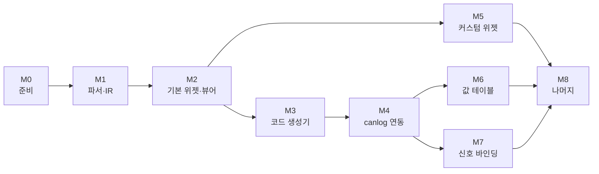

# panel_to_rust_egui 개발 계획서

작성일: 2026-10-14. 근거: [변환 검토서](xvp-to-egui-review.md).

## 목적과 범위

CANoe 패널 파일(`.xvp`)을 egui 위젯 코드로 바꾸고, 그 결과를 canlog GUI(`canlog-gui-egui`)에 선택 기능으로 컴파일해 넣는다. 패널은 canlog가 CAPL 노드를 돌리는 온라인 세션에서 시스템 변수를 읽고 쓴다.

| 범위 안 | 범위 밖 |
| --- | --- |
| XVP 파싱과 중간 표현(IR) | CAPL 변환 (capl_to_rust의 일) |
| egui 위젯 라이브러리 (기본 13종, 커스텀 9종) | ActiveX·.NET 사용자 컨트롤, DLL로 구현된 패널 |
| XVP를 바로 그리는 검증용 뷰어 | CANoe 창 (Trace, Graphics 등) |
| IR → Rust 코드 생성기 | 서비스 신호·통신 객체(SOME/IP 등) 바인딩 |
| canlog 어댑터와 `panels` 기능 | |
| 신호 바인딩 (canlog·caplgen 변경 요청 포함) | |

기간은 산정하지 않았다. 작업량은 단계의 순서와 완료 기준으로 관리한다. 단계 표의 규모(S·M·L)는 상대 비교용 추정이다.

## 전제와 가정

확정된 것은 egui 0.36.2(canlog가 고정한 버전)와 canlog에 컴파일해 붙이는 방식이다. 아래 네 가지는 아직 정해지지 않았고, 이 계획은 표의 가정으로 짰다. 바뀌면 영향을 받는 단계를 다시 본다.

| 미결 사항 | 계획의 가정 | 바뀌면 |
| --- | --- | --- |
| 패널 묶음이 하나로 고정인가 | 고정 (컴파일해 넣음) | CFG마다 달라지면 canlog가 XVP를 실행 중에 읽는 방식을 M8에 더한다. 파서와 위젯은 공유한다 |
| 생성 코드를 두는 곳 | canlog 밖의 폴더, canlog가 경로로 참조 | canlog 저장소에 넣으면 M4의 빌드 구성과 `.gitignore`가 바뀐다 |
| 신호 바인딩 쓰기 | 읽기를 먼저, 쓰기는 M7 | 읽기만 필요하면 M7의 쓰기 항목을 뺀다 |
| 화면 일치 수준 | 배치와 동작은 동일, 위젯 모양은 egui 스타일 | 픽셀 일치가 목표면 기본 위젯도 직접 그려야 해서 M2가 커진다 |

실제로 변환할 패널(CFG와 패널 폴더)은 아직 받지 못했다. 받으면 M1에서 같은 집계를 돌려 M5 이후의 우선순위를 정한다.

## 저장소 구성

```text
panel_to_rust_egui/
  Cargo.toml                 워크스페이스. edition 2021, rust-version 1.95 (canlog GUI와 같음)
  crates/
    xvp-parser/              XML → IR. egui에 의존하지 않는다
    panel-widgets/           egui 위젯, PanelHost 트레이트, 이미지 로더. canlog에 복사되는 크레이트
    xvp-viewer/              XVP를 컴파일 없이 그리는 앱 (가짜 값 호스트)
    xvp2egui/                IR → Rust 소스 생성기 (CLI)
  tests/                     샘플 순회, IR 스냅샷, 생성 코드 빌드 시험
  docs/
```

- **샘플은 저장소에 넣지 않는다.** Vector 샘플의 XVP와 비트맵은 Vector 소유다. 시험은 환경 변수(이름은 예시: `XVP_CORPUS`)로 폴더를 받고, 없으면 `skipped`를 출력하고 넘어간다. canlog가 `caplgen.exe` 없을 때 시험을 건너뛰는 방식과 같다.
- **`panel-widgets`는 egui 외에 의존하지 않는다.** canlog는 이 크레이트를 `engines/panel/`에 복사하고 `manifest.json`에 출처 커밋과 해시를 적는다. egui는 `=0.36.2`로 고정한다.
- **`xvp-parser`는 egui를 모른다.** 뷰어, 생성기, 시험이 같은 IR을 쓴다.

## 단계

| 단계 | 목표 | 규모 | 선행 |
| --- | --- | --- | --- |
| M0 | 준비 | S | |
| M1 | 파서와 IR | M | M0 |
| M2 | 기본 위젯과 뷰어 | L | M1 |
| M3 | 코드 생성기 | M | M2 |
| M4 | canlog 연동 (시스템 변수) | L | M3, 미결 1·2번 |
| M5 | 커스텀 위젯 | L | M2 |
| M6 | 값 테이블 | M | M4 |
| M7 | 신호 바인딩 | L | M4 |
| M8 | 나머지 | M | M5~M7 |



화살표는 선행 관계다. M5는 뷰어로 확인할 수 있어서 canlog 연동(M3, M4)과 나란히 진행할 수 있다. M7은 canlog와 caplgen 저장소의 변경이 필요하므로 요청은 M4보다 앞서 낸다(아래 "다른 저장소에 요청할 변경").

### M0. 준비

- 워크스페이스와 크레이트 뼈대를 만든다. canlog와 같은 `edition`, `rust-version`을 쓴다.
- 샘플 순회 시험의 틀을 만든다. 폴더를 재귀로 돌며 `*.xvp`를 모으고, 폴더가 없으면 건너뛴다.
- CI를 만든다. 형식 검사, 빌드, 시험을 돌린다. 샘플이 없는 환경이므로 샘플 시험은 건너뛰어도 통과해야 한다.

완료 기준: `cargo test`가 샘플이 있는 PC와 없는 PC에서 모두 통과한다.

### M1. 파서와 IR

IR은 정보를 버리지 않는다. 해석하지 못한 속성은 원문 문자열로 남긴다.

- **트리.** `Panel`, `Object`, `Property`를 읽어 컨트롤 트리를 만든다. 컨트롤 종류는 `Type`의 클래스 이름으로 구분한다.
- **기본값 표.** 컨트롤 종류별로, 저장되지 않은 속성의 기본값을 채운다. 샘플에서 관찰한 (종류, 속성) 조합 430개가 기준이다.
- **값 파서.** 좌표·크기(`131, 47`), 색(`221, 221, 221`과 .NET 색 이름), 글꼴(`Arial, 10pt, style=Bold`), 정렬(`MiddleCenter` 등).
- **심볼 바인딩.** `SymbolConfiguration`을 종류(시스템 변수, 버스 신호, 구조체 멤버, 환경 변수, 서비스·통신 객체)로 나눠 읽는다. 필드 수가 6~14개로 다르므로 버전 필드로 갈라 읽는다. 이름 경로 밖의 필드는 원문으로 보존한다.
- **상태 값.** `SwitchValues`, `SwitchValuesRx`, `SwitchValuesVT`의 세 형식(`<Version>2</Version>…` XML 형식 포함)을 읽는다.
- **보고서.** 모르는 컨트롤, 모르는 속성, 없는 이미지를 모아 보고서로 낸다. 오류로 멈추지 않는다.

완료 기준:

- 샘플 1,526개가 모두 IR이 된다.
- 관찰한 (종류, 속성) 430개가 모두 "처리함" 또는 "무시함, 사유"로 분류되어 있다.
- 대표 패널 약 10개의 IR이 JSON 스냅샷으로 저장되어 있고, 파서를 고치면 차이가 시험에서 보인다.
- 집계 도구가 컨트롤 종류별·바인딩 종류별 개수를 낸다. 실제 변환 대상 패널에 같은 도구를 돌릴 수 있다.

### M2. 기본 위젯과 뷰어

`PanelHost` 트레이트(심볼 이름으로 값을 읽고 쓰는 두 동작)를 먼저 정한다. 위젯은 이것만 알고 canlog를 모른다.

| 위젯 | 대응 컨트롤 |
| --- | --- |
| 라벨, 그룹 박스 | StaticTextControl, GroupBoxControl |
| 텍스트 박스 | TextBoxControl (표시 형식: 10진, 16진, 이진, 심볼. 경보 색) |
| 버튼 | ButtonControl (누를 때·뗄 때 값) |
| 체크 박스, 라디오 버튼 | CheckBoxControl, RadioButtonControl |
| 슬라이더 | TrackBarControl (세로, 눈금, 최소·최대 표시) |
| 이미지 | PictureBoxControl |
| 콤보 박스 | ComboBoxControl (항목은 M6 전까지 비워 둠) |
| 진행 막대 | ProgressBarControl |
| 탭 | VectorTabControl, VectorTabPage |
| 숫자 입력 | NumericUpDownControl |

- **배치.** 절대 좌표(`ui.put`)를 쓴다. 패널의 `IsProportional`이 켜진 경우에만 창 크기에 맞춰 늘린다.
- **글꼴.** pt를 px로 바꾼다. Microsoft Sans Serif와 Arial은 canlog 글꼴(맑은 고딕)로 대체되므로 글자 폭이 달라진다. 글자가 잘리지 않는지 확인한다.
- **이미지.** bmp, png, jpg, gif를 읽는다. `TransparentColor`로 지정한 색을 알파로 바꾼다. 없는 파일은 빈 자리 표시로 그리고 보고서에 기록한다.
- **뷰어.** XVP를 열어 바로 그린다. 가짜 값 호스트에 값을 넣고 조작하는 창을 둔다. 읽기 전용 컨트롤은 값을 쓰지 않는다.

완료 기준: Easy 샘플의 Control·Display 패널이 CANoe 화면과 같은 배치로 뜨고, 컨트롤을 조작하면 가짜 값 호스트의 쓰기 목록에 값이 들어간다. 비교용 CANoe 화면 캡처는 이 단계 시작 전에 준비한다.

### M3. 코드 생성기

- **출력.** 패널마다 Rust 모듈 하나, 패널 목록, 이미지 복사본. 컨트롤 이름을 식별자로 쓰고 좌표와 범위는 숫자 그대로 적는다.
- **원본 정보.** 생성 코드에 원본 XVP의 해시와 필요한 심볼 목록을 적는다. canlog가 연 CFG와 패널이 어긋났는지 확인하는 데 쓴다.
- **덮어쓰기.** 생성 파일과 사용자가 쓰는 파일을 분리한다. 다시 생성해도 손으로 쓴 코드는 지워지지 않는다.
- **시스템 변수 이름.** XVP는 네임스페이스와 이름을 따로 저장한다. canlog 형식(`네임스페이스::이름`)으로 합쳐서 적는다.

완료 기준:

- 기본 위젯만 쓰는 패널은 생성 코드가 수정 없이 빌드된다.
- 같은 패널을 뷰어로 그린 것과 생성 코드로 그린 것이 같다(`egui_kittest`로 비교).
- 시험에 "생성 코드를 빌드한다"가 들어 있고, 빌드되지 않는 코드가 나오면 실패한다.

### M4. canlog 연동 (시스템 변수)

canlog 저장소(`najari/codex_test`)에서 하는 작업이다. 변경을 작게 유지하기 위해 `files/ui.rs`에는 호출만 더하고 나머지는 별도 파일에 둔다.

- `engines/panel/`에 `panel-widgets`를 복사하고 `manifest.json`에 출처 커밋과 해시를 적는다.
- `gui/egui`에 `panels` 선택 기능을 더하고 `scripts/build.ps1`에 스위치를 더한다.
- 패널 어댑터를 만든다. `PanelHost`를 canlog 백엔드의 `node_variables`(읽기)와 `set_node_variable`(쓰기)로 구현한다. 쓰기는 작업 스레드에서 부른다.
- View 메뉴에 패널 창을 더한다. 패널은 크기가 고정이므로 떠 있는 창으로 먼저 넣는다.
- CAPL 노드가 도는 세션이 없으면 `This session runs no CAPL nodes` 오류가 나므로 패널을 비활성으로 표시한다.
- 갱신 주기를 측정한다. 현재 Node variables 창은 0.3초마다 묻는다. 계기판이 끊겨 보이지 않는 주기와 그때의 부하를 잰다. 열려 있는 패널이 있을 때만 자주 묻는다.
- 세션에 없는 변수에 묶인 컨트롤은 비활성으로 표시한다.

완료 기준:

- CAPL 노드가 도는 온라인 세션에서 패널 버튼이 시스템 변수를 쓰고, 노드가 프레임을 보낸다. canlog의 `tests/vector_capl_nodes.rs`와 같은 시나리오(가상 채널)로 시험한다.
- `panels` 기능을 켠 빌드와 끈 빌드를 모두 시험한다. 끈 빌드가 지금과 달라지면 실패다.

### M5. 커스텀 위젯

`Painter`로 직접 그리는 위젯이다. M2의 뷰어로 확인할 수 있어서 M4와 나란히 진행해도 된다.

| 위젯 | 대응 컨트롤 | 개수 | 확인할 것 |
| --- | --- | --- | --- |
| 비트맵 스위치 | SwitchControl | 3,178 | 이미지 조각 규칙 |
| LED | LEDControl | 323 | 원, 사각형, 삼각형, 켜짐·꺼짐 색 |
| 바늘 계기 | MeterControl | 97 | 배경 이미지 위에 바늘만 그림. 각도 범위와 바늘 모양 |
| 아날로그 계기판 | AnalogGaugeControl | 61 | 눈금, 색 구간(`CriticalProps`) |
| 7세그먼트 | LCDControl, ClockControl | 83 | 정수·소수 자릿수 |
| 헥스 편집기 | HexEditorControl | 165 | 열 수, 필드·텍스트 보기 |
| 기타 | LEDBand, CompassControl | 20 | |

스위치의 이미지 조각 규칙이 먼저 풀려야 한다. 디스크에 이미지가 있는 스위치 2,832개 중 1,578개는 너비가 `StateCnt`와 `StateCnt + 1` 모두로 나누어떨어져 규칙을 알 수 없고, 199개는 어느 쪽으로도 나누어떨어지지 않는다. CANoe에서 스위치를 바꿔 가며 확인하고, 규칙이 확정되기 전에는 모호한 경우를 보고서로 남긴다.

완료 기준: CANMainDemo의 Dashboard 패널이 가짜 값으로 움직인다.

### M6. 값 테이블

- 콤보 박스 항목과 심볼 표시값은 XVP에 없고 DBC와 시스템 변수 정의에 있다. 변환 시점에 읽어 생성 코드에 넣는다.
- 먼저 조사한다. canlog의 DBC 엔진(`candb-engine`)과 CFG 엔진(`cfg_core`의 `sysvar.rs`)이 값 테이블과 범위를 읽어 줄 수 있는지 확인한다. 안 되면 변환기에 읽기를 직접 구현한다.

완료 기준: 콤보 박스 항목과 심볼 표시가 CANoe와 같다.

### M7. 신호 바인딩

패널 연동에서 가장 비용이 큰 단계다. 세 저장소에 걸친다.

| 방향 | 하는 일 | 변경할 저장소 |
| --- | --- | --- |
| 읽기 | 신호 이름으로 최신 해석 값을 돌려주는 함수. 세션은 DBC로 신호를 이미 해석해 저장하지만 백엔드에는 Graph·내보내기용 함수뿐이다 | canlog |
| 쓰기 | `caplgen live`에 신호 쓰기 한 줄(예: `{"signal": …}`)을 더하고 Interaction Layer의 값 설정에 연결. canlog는 그 줄을 보낸다 | capl_to_rust, canlog |
| 이름 | XVP의 (DB, 노드, 메시지, 신호, 채널)을 canlog·caplgen의 신호 식별자로 바꾸는 규칙 | 변환 툴 |

- 쓰기는 `caplgen`이 이미 가진 것(CAPL의 `$Msg::Sig = v`를 Interaction Layer 설정으로 변환)에 통로를 내는 일이다. 송신 로직을 새로 짜지 않는다.
- 쓴 신호는 그 메시지를 보내는 노드가 `caplgen`에서 돌 때만 버스에 나간다. 실제 ECU가 보내는 신호는 표시만 한다.
- 읽기는 쓰기와 별개로 먼저 끝낼 수 있다. 쓰기가 필요 없으면 쓰기 항목을 뺀다.

완료 기준:

- 신호에 묶인 계기판이 가상 채널의 버스 값을 따라 움직인다.
- (쓰기를 하는 경우) 신호에 묶인 버튼이 값을 쓰면 노드가 보낸 프레임이 가상 채널에 관측된다.

### M8. 나머지

- 구조체·배열 시스템 변수의 멤버(샘플의 2%), 환경 변수(2%). canlog가 읽고 쓸 수 있는지 먼저 확인한다.
- CANoe 의존 컨트롤의 대체 동작: PanelButton(앱 안의 창 전환), PanelHelp(파일 열기), CAPLOutputView(노드의 `write()` 출력, canlog는 최근 200줄을 보관), Path(파일 선택 대화상자), StartStop 등.
- CAPL의 패널 조작 함수(`enableControl`, `putValueToControl` 등). 패널에 컨트롤 이름으로 접근하는 API를 두고, capl_to_rust가 그 호출을 내보내게 하는 일은 capl_to_rust 쪽 작업이다.
- 미결 1번이 "CFG마다 다름"으로 정해지면 실행 중에 XVP를 읽어 그리는 방식을 더한다. 파서와 위젯은 공유한다.

## 다른 저장소에 요청할 변경

| 저장소 | 변경 | 필요한 단계 |
| --- | --- | --- |
| canlog | `engines/panel/`, `panels` 기능, 패널 어댑터, View 메뉴, `build.ps1` 스위치 | M4 |
| canlog | 열려 있는 패널이 있을 때 값 갱신 주기를 줄이는 방법 | M4 |
| canlog | 신호 이름으로 최신 값을 돌려주는 백엔드 함수 | M7 |
| canlog | `caplgen live`의 신호 쓰기를 보내는 함수 | M7 |
| capl_to_rust | `caplgen live`의 신호 쓰기 줄 (Interaction Layer 연결) | M7 |
| capl_to_rust | 패널 조작 함수 지원 | M8 |

M7의 요청은 M2가 끝날 즈음 낸다. 변경이 두 저장소에 걸치므로, 그 시점에 신호 식별자 형식과 쓰기 줄의 모양을 먼저 합의한다.

## 시험 전략

| 대상 | 방법 |
| --- | --- |
| 파서 | 샘플 전체를 돌려 IR 스냅샷을 비교한다. 모르는 속성 목록이 줄어드는지 추적한다 |
| 값 파서 | 색, 글꼴, 심볼 문자열, 상태 값의 단위 시험. 샘플에서 뽑은 실제 문자열을 쓴다 |
| 화면 | 대표 패널을 정해 CANoe 화면 캡처와 렌더링 결과를 나란히 비교한다 |
| 위젯 동작 | 가짜 값 호스트에 값을 넣고 컨트롤 상태를 확인한다. 반대로 조작하고 쓰기 목록을 확인한다. canlog와 같은 `egui_kittest`(`=0.36.2`)를 쓴다 |
| 코드 생성 | 생성 코드를 빌드한다. 뷰어와 같은 화면인지 비교한다 |
| canlog 안 | `panels` 기능을 켠 빌드와 끈 빌드를 모두 시험한다. 가상 채널의 CAPL 노드로 쓰기와 프레임 송신을 확인한다 |

화면 비교용 캡처 기준은 M2 시작 전에 정한다. CANoe 13.0이 설치된 PC에서 직접 찍을 수 있다.

## 위험과 대응

자세한 표는 [검토서](xvp-to-egui-review.md#리스크와-한계)에 있다. 계획에 영향을 주는 것만 뽑는다.

| 위험 | 영향 단계 | 대응 |
| --- | --- | --- |
| 포맷 문서가 없어 `SymbolConfiguration`과 상태 값의 의미가 추정이다 | M1, M5, M7 | 모르는 필드는 원문으로 보존한다. CANoe에서 값을 바꿔 저장해 차이를 확인한다 |
| 실제 변환 대상 패널을 아직 받지 못했다 | M5 이후 | 받는 즉시 M1의 집계를 돌려 우선순위를 다시 정한다 |
| 신호 쓰기가 세 저장소에 걸친다 | M7 | 읽기와 쓰기를 나눈다. 요청을 일찍 내고 식별자 형식을 먼저 합의한다 |
| 갱신 주기가 계기판에 충분하지 않다 | M4 | 주기와 부하를 측정해서 정한다 |
| egui 버전이 올라가면 위젯 라이브러리도 같이 올려야 한다 | M2 이후 | 생성 코드는 egui를 직접 부르지 않고 `panel-widgets`만 부른다 |
| 글꼴 대체로 글자가 잘린다 | M2 | 글자 폭 여유를 두고, 잘림이 있는 패널을 화면 비교에서 걸러 낸다 |

## 바로 시작할 작업

- [ ] 워크스페이스와 크레이트 뼈대 (M0)
- [ ] 샘플 순회 시험 틀, CI (M0)
- [ ] 컨트롤 트리 파서와 컨트롤별 기본값 표 (M1)
- [ ] 색, 글꼴, 좌표 값 파서 (M1)
- [ ] `SymbolConfiguration` 파서 (M1)
- [ ] 집계·보고서 도구 (M1)
- [ ] 비교용 CANoe 화면 캡처 준비 (M2 시작 전)
- [ ] 변환 대상 패널과 CFG 받기 (M1 이후 우선순위 확정)
- [ ] 미결 1·2번 결정 (M4 시작 전)
