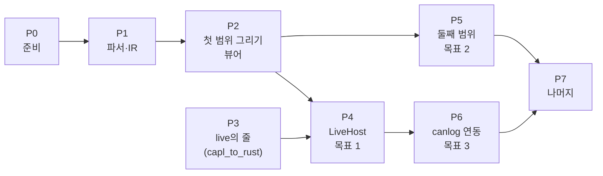

# XVP → egui 패널 구현 계획서

작성일: 2026-10-14. 근거: [설계서](design.md). 앞 문서: [개발 계획서](development-plan.md), [구현 검토 의견](implementation-review.md).

이 계획은 설계서의 결정(실행 중에 그린다, 컨트롤을 직접 그린다, 신호도 `caplgen live`의 줄로)을 따른 것이다. 앞의 개발 계획서와는 단계의 묶음과 순서가 다르다. 끝의 [대응표](#개발-계획서와의-대응)에 차이를 적었다.

## 목표

1. Easy 샘플의 두 패널(Control, Display)이 뷰어에서 `caplgen live`에 붙어 돈다. 스위치와 슬라이더를 움직이면 노드가 프레임을 보내고, 그 값이 계기와 표시등에 돌아온다.
2. `CANSystemDemo`의 패널 10개가 같은 방식으로 돈다.
3. 같은 크레이트가 canlog GUI에 들어가 CFG의 패널을 창으로 띄운다.

기간은 정하지 않았다. 규모(S·M·L)는 단계끼리의 비교다.

## 맡는 곳

| 저장소 | 하는 일 | 맡는 쪽 |
| --- | --- | --- |
| `panel_to_rust_egui` | 파서, 그리기, 뷰어, 호스트 | 이 계획을 쓴 쪽 |
| `capl_to_rust` | `caplgen live`에 더할 줄 | 이 계획을 쓴 쪽 |
| `codex_test` (canlog) | `engines/panel/`, 어댑터, 패널 창 | canlog를 작업하는 쪽. 이 저장소가 주는 것은 크레이트와 `PanelHost`의 약속이다 |

## 단계

| 단계 | 내용 | 규모 | 선행 | 저장소 |
| --- | --- | --- | --- | --- |
| P0 | 준비 | S | | 변환 툴 |
| P1 | 파서와 IR | M | P0 | 변환 툴 |
| P2 | 첫 범위의 그리기, 뷰어, 가짜 값 | L | P1 | 변환 툴 |
| P3 | `caplgen live`의 신호 줄과 변수 정보 | S | | capl_to_rust |
| P4 | `LiveHost`: 뷰어를 `caplgen live`에 붙인다 | M | P2, P3 | 변환 툴 |
| P5 | 둘째 범위의 컨트롤 | L | P2 | 변환 툴 |
| P6 | canlog 연동 | M | P4 | canlog |
| P7 | 나머지 | M | P5, P6 | 셋 다 |

P3은 다른 저장소의 작은 일이라 P1, P2와 나란히 한다. P5는 P4를 기다리지 않는다.

### P0. 준비

- 워크스페이스와 크레이트 뼈대(`xvp-parser`, `panel-widgets`, `panel-view`, `xvp-viewer`). `edition`과 `rust-version`은 canlog GUI와 같게(2021, 1.95). egui는 `=0.36.2`.
- 지어낸 XVP 몇 개를 `tests/fixtures/`에 둔다. 샘플에서 본 꼴을 쓰되 값과 이름은 지어낸다. 저장소의 시험은 이것만으로 돈다.
- 샘플 순회 시험의 틀. 환경 변수(`XVP_CORPUS`)로 폴더를 받아 `*.xvp`를 모으고 내용의 해시로 중복을 뺀다. 변수가 없으면 건너뛴다고 말하고 통과한다.
- CI: 형식 검사, clippy, 빌드, 시험. 샘플이 없는 환경에서 통과해야 한다.

완료 기준: `cargo test`가 샘플이 있는 PC와 없는 PC에서 통과한다.

### P1. 파서와 IR

- 트리: `Panel`, `Object`, `Property`를 읽어 `Control` 트리를 만든다. 종류는 `Type`의 마지막 마디.
- 값 문법: 크기와 위치, 색(RGB와 .NET 이름, 시스템 색), 글꼴, 불, 열거, 경로.
- `SymbolConfiguration`: 종류 1, 2, 16, 128을 이름으로 푼다. 그 밖의 종류는 `Other`로 두고 줄을 남긴다.
- 스위치의 상태 값: `SwitchValues`, `SwitchValuesRx`(값과 범위), `SwitchValuesVT`의 두 형식.
- 보고서: 모르는 종류, 풀지 못한 값, 없는 이미지. 오류로 멈추지 않는다.
- 집계 도구(`xvp-stat`): 폴더를 받아 종류·속성·바인딩의 개수를 낸다. 실제 변환 대상 패널이 오면 이것으로 P5의 순서를 정한다.
- IR을 JSON으로 낸다.

완료 기준:

- 샘플 764개가 모두 IR이 되고, 설계서에 적은 개수(32종, 조합 430개, 종류별 바인딩 수)가 집계 도구에서 그대로 나온다.
- 지어낸 XVP의 IR이 스냅샷으로 저장되어 있다.
- 첫 범위의 컨트롤이 읽는 속성은 모두 "푼다"로, 나머지는 "원문으로 둔다"로 분류되어 있다.

### P2. 첫 범위의 그리기, 뷰어, 가짜 값

첫 범위는 Easy의 두 패널에 나오는 여덟 종이다: Panel, StaticText, GroupBox, PictureBox, Switch, TrackBar, TextBox, AnalogGauge.

- `PanelHost`, `Value`, `SymbolInfo`를 정한다. 여기서 정한 것이 canlog 어댑터와의 약속이 된다.
- `panel-widgets`: 여덟 종을 사각형 안에 직접 그린다. 입력은 `ui.interact`로 받는다. 글자 입력만 egui의 `TextEdit`을 쓴다.
- `panel-view`: IR을 돌며 그린다. 좌표, 순서, 잘라 내기, 비례 배치. 심볼을 호스트로 풀고, 풀리지 않으면 비활성으로 그린다.
- 이미지: bmp, png, jpg, gif를 읽어 투명색을 알파로 바꾸고 텍스처로 올린다. 스위치는 `StateCnt + 1` 조각으로 자른다.
- 글꼴: Windows 글꼴 폴더에서 패널이 부르는 글꼴을 읽어 등록한다. 없으면 기본 글꼴.
- 색: .NET 색 이름 표, 시스템 색의 고정값.
- 뷰어: XVP를 열어 그린다. `FakeHost`의 값을 넣고 보는 창, 쓴 값의 목록.
- 그림으로 확인: `egui_kittest`로 패널을 PNG로 떠서 본다.

완료 기준:

- Easy의 Control·Display 패널이 뷰어에 뜬다. 컨트롤의 자리와 크기가 XVP의 값과 같고, 넘치거나 잘린 글자가 없다(PNG로 확인).
- `FakeHost`에 값을 넣으면 스위치의 조각, 계기의 바늘, 텍스트 박스의 글자가 바뀐다.
- 스위치를 누르고 슬라이더를 끌면 쓴 값의 목록에 `SwitchValues`와 범위에 맞는 값이 들어간다.
- 지어낸 패널로 같은 것을 보는 시험이 저장소에 있다.

이 단계에서 CANoe 화면과 견줘야 하는 것(아래 "CANoe로 확인할 것")은 가설대로 구현해 두고, 확인되면 고친다.

### P3. `caplgen live`의 신호 줄과 변수 정보

`capl_to_rust`에서 한다. 설계서의 "더할 줄" 가운데 다음이다.

- 입력 `{"signal": {"name": "Msg::Sig", "value" | "raw": …}}`: 호스트의 `inject_il_signal`로 간다. 그 메시지를 보내는 노드가 없으면 `note`.
- 입력 `{"watch": {"signals": […]}}`와 출력 `{"signal": {…}}`: 버스의 프레임(노드가 보낸 것과 `rx`로 들어온 것)에서 지켜보는 신호의 값이 바뀌면 알린다.
- `ready.sysvars[]`에 `min`, `max`, `unit`, `labels`. `ready.signals[]`.
- 설명서 5.6과 `apps/caplgen/tests/live.rs`의 시험.

완료 기준: 지어낸 구성으로 `live`를 띄워 신호를 쓰면 노드가 그 값을 실은 프레임을 보내고, 지켜보는 신호의 줄이 나온다. canlog 쪽 Claude가 재검토에서 "프로토콜에 줄이 없어 뺐다"고 한 `signal` 입력 10개가 들어간다.

### P4. `LiveHost`: 뷰어를 `caplgen live`에 붙인다

- `LiveHost`: `caplgen live <구성>`을 띄우고, `ready`로 심볼을 풀고, `sysvar`·`signal` 줄을 받아 값의 표에 두고, 쓴 값을 줄로 보낸다.
- 뷰어의 명령줄: `xvp-viewer <패널.xvp>... --cfg <구성.cfg | cfg.json> [--caplgen <경로>]`.
- 노드가 `write()`로 한 말과 `note`를 보여 주는 칸.
- 구성의 패널 목록을 읽어 한 번에 여는 것은 canlog의 CFG 엔진이 하는 일이다. 뷰어는 XVP를 직접 받는다.

완료 기준 (목표 1):

- Easy에서 점화 스위치를 켜고 속도 슬라이더를 2500으로 끌면 Display의 계기가 2.5를 가리키고, 전조등 스위치(신호 `LightState::HeadLight`)를 누르면 Display의 등이 켜진다.
- 같은 흐름을 지어낸 구성과 지어낸 패널로 보는 시험이 저장소에 있다(`caplgen`이 없으면 건너뛴다).

### P5. 둘째 범위의 컨트롤

`CANSystemDemo`의 패널 10개에 더 나오는 것부터 한다: LED 20, Button 3, Clock 2, ProgressBar 2, Meter 2, ComboBox 1, PanelHelp 1. 그다음은 샘플 전체의 개수 순이다.

| 묶음 | 컨트롤 (샘플 전체의 개수) |
| --- | --- |
| 가 | LED 163, Button 1,523, ProgressBar 104, ComboBox 237, Clock·LCD 42, Meter 50 |
| 나 | CheckBox 1,085, RadioButton 525, NumericUpDown 79, Tab 99 |
| 다 | HexEditor 82, LEDBand·Compass 10 |

실제로 변환할 패널을 받으면 `xvp-stat`의 결과로 이 순서를 다시 정한다.

완료 기준 (목표 2): `CANSystemDemo`의 패널 10개가 뷰어에서 `caplgen live`에 붙어 뜬다. 점화와 시동의 스위치로 두 네트워크가 깨어나고(`ComfortBus::GatewaySwitchIgnition` 3, `ComfortBus::GatewayStarter` 1), 계기와 표시등이 노드의 값을 따른다. 그리지 못한 컨트롤은 빈 자리와 이름으로 보이고 보고서에 남는다.

### P6. canlog 연동

canlog 저장소의 일이다. 이 저장소가 주는 것은 다음이다.

- 세 크레이트(`xvp-parser`, `panel-widgets`, `panel-view`)와 그 커밋. canlog는 `engines/panel/`에 복사한다.
- `PanelHost`의 약속과, `LiveHost`가 `caplgen live`의 줄을 다루는 방식(어댑터의 본보기).
- 어댑터가 풀어야 하는 것의 목록: 변수는 `node_variables`와 `set_node_variable`, 신호 읽기는 `graph_range` 또는 `watch`, 신호 쓰기는 `signal` 줄.

canlog에서 할 일은 설계서의 "canlog에 넣는 방법"에 있다: `panels` 기능, CFG의 패널 목록에서 창 띄우기, 어댑터, 세션이 없을 때의 비활성 표시.

완료 기준 (목표 3): canlog에서 `CANSystemDemo.cfg`로 온라인 세션(가상 채널)을 열고 View 메뉴에서 패널을 고르면 창이 뜬다. 패널의 스위치가 시스템 변수를 쓰고 노드가 프레임을 보낸다. `panels` 기능을 끈 빌드는 지금과 같다.

### P7. 나머지

- **패널 조작 함수.** `capl_to_rust`가 `enableControl`, `putValueToControl`, `SetControlVisibility`, `SetControlBackColor`, `SetControlForeColor`, `setControlColors`, `SetControlProperty`를 stub 대신 `panel` 줄로 내보낸다. `panel-view`가 컨트롤 이름으로 그 값을 덮어쓴다. 노드가 이 함수를 얼마나 쓰는지 먼저 센다.
- **CANoe 기능에 묶인 컨트롤.** PanelButton(다른 패널을 연다), PanelHelp(파일을 연다), CAPLOutputView(노드의 `write()`), Path(파일 고르기), StartStop.
- **환경 변수.** 이름의 꼴을 확인하고, 줄이 필요하면 더한다.
- **코드 생성.** 사람이 고쳐 쓸 패널 코드가 필요해지면 `xvp2egui`를 만든다. `panel-widgets`만 부르는 코드를 낸다.
- **로그 재생의 패널.** canlog가 로그의 변수와 신호 값을 돌려주므로, 재생 위치의 값을 보여 주는 읽기 전용 호스트가 가능하다. 필요하면 한다.

## CANoe로 확인할 것

설계서의 "확인이 필요한 것" 가운데 그림과 동작에 영향을 주는 것이다. CANoe 13.0이 이 PC에 있으나, 내가 그 화면을 조작할 수 있는지는 해 보지 않았다.

| | 확인할 것 | 쓰이는 단계 | 확인하는 법 |
| --- | --- | --- | --- |
| 1 | 스위치 비트맵의 첫 조각이 그려지는 때 | P2 | 값이 상태에 없을 때의 화면 |
| 2 | `TransparentColor`가 없을 때의 투명색 | P2 | Easy의 Control 패널 화면(바탕이 파랑인지) |
| 3 | 겹친 컨트롤의 순서, 그룹 박스 안의 원점 | P2 | 겹친 패널의 화면 |
| 4 | 스위치·슬라이더·글자 입력이 값을 쓰는 때 | P2, P4 | CANoe의 Trace나 Write 창 |
| 5 | 저장되지 않은 속성의 기본값 | P2, P5 | Panel Designer에서 새 컨트롤을 놓고 값을 본다 |
| 6 | `SymbolConfiguration`의 뒤쪽 필드 | P1 | 바인딩을 바꿔 저장하고 줄을 견준다 |

먼저 필요한 것은 Easy의 두 패널과 `CANSystemDemo` 패널의 화면 캡처다. 내가 CANoe를 띄워 찍는 것을 P2 시작 때 해 보고, 안 되면 캡처를 받는다. 캡처가 없어도 P1과 P2의 구현은 가설대로 나아가고, 확인이 오면 고친다.

## 다른 저장소의 변경

| 저장소 | 변경 | 단계 |
| --- | --- | --- |
| capl_to_rust | `live`의 `signal` 입력, `watch`와 `signal` 출력, `ready`의 변수·신호 정보 | P3 |
| capl_to_rust | 패널 조작 함수를 `panel` 줄로 | P7 |
| canlog | `engines/panel/`, `panels` 기능, 어댑터, 패널 창 | P6 |
| canlog | `caplgen live`의 `signal`·`watch` 줄을 보내고 받기 | P6 |

## 시험

| 단계 | 저장소 안에서 도는 것 | 샘플이 있을 때 더 도는 것 |
| --- | --- | --- |
| P1 | 값 문법의 단위 시험, 지어낸 XVP의 IR 스냅샷 | 764개 순회, 개수 대조 |
| P2 | 지어낸 패널을 그려 도형과 쓴 값을 본다 | Easy의 두 패널을 PNG로 떠서 본다 |
| P3 | `live.rs`의 시험(지어낸 구성) | |
| P4 | 지어낸 구성과 패널로 `LiveHost`의 왕복 | Easy로 같은 왕복 |
| P5 | 컨트롤마다 지어낸 패널 | `CANSystemDemo`의 패널 10개 |

Vector의 XVP, 비트맵, 그것으로 뜬 그림은 저장소에 넣지 않는다. 기준 그림이 필요하면 `XVP_CORPUS`와 같은 방식으로 저장소 밖의 폴더에서 받는다.

## 위험

| 위험 | 단계 | 대응 |
| --- | --- | --- |
| CANoe 화면을 얻지 못한다 | P2 | 가설대로 구현하고, 확인할 것의 목록을 문서로 유지한다. 캡처를 받으면 고친다 |
| 직접 그린 컨트롤이 Windows Forms와 달라 보인다 | P2, P5 | 목표는 같은 자리·크기·색이다. 모양의 차이는 캡처와 나란히 놓고 정한다 |
| 텍스트 박스의 형식과 경보가 생각보다 많다 | P2 | `ValueDisplay` 여섯 가지와 경보 색부터. 나머지 속성은 보고서에 남긴다 |
| 기본값을 모른다 | P2, P5 | 그리는 코드가 읽는 속성만 채운다. Vector의 DLL에서 읽은 값을 저장소에 싣기 전에 조건을 확인한다 |
| `watch`가 프레임마다 신호를 풀어 `live`가 느려진다 | P3 | 지켜보는 신호가 든 메시지만 푼다. 값이 바뀔 때만 줄을 낸다 |
| canlog의 일정과 맞지 않는다 | P6 | P4의 뷰어가 canlog 없이 끝까지 돈다. canlog는 준비될 때 붙인다 |
| egui가 올라간다 | 전체 | egui를 부르는 곳은 `panel-widgets`와 `panel-view`다. canlog가 올릴 때 함께 올린다 |

## 정해야 할 것

1. **실행 중에 그리는 방식.** 이 계획의 전제다. 컴파일해 넣는 방식이 꼭 필요하면 P7의 코드 생성을 앞으로 당긴다.
2. **canlog 쪽을 누가 하는가.** 이 계획은 canlog를 작업하는 쪽이 P6을 한다고 보았다.
3. **실제로 변환할 패널.** 받으면 P1의 집계로 P5의 순서를 다시 정한다.
4. **신호를 `watch`로 읽을 것인가.** 뷰어는 그렇게 한다. canlog가 `graph_range`만으로 충분하다고 보면 canlog는 그쪽을 쓴다.

## 바로 시작할 작업

- [ ] 워크스페이스와 크레이트 뼈대, CI (P0)
- [ ] 지어낸 XVP와 샘플 순회 시험의 틀 (P0)
- [ ] 트리 파서와 값 문법 (P1)
- [ ] `SymbolConfiguration`과 스위치 상태 값 (P1)
- [ ] 집계 도구와 보고서 (P1)
- [ ] `live`의 `signal` 입력 (P3, capl_to_rust)
- [ ] Easy의 두 패널 화면 캡처를 직접 찍어 보기 (P2 시작 전)

## 개발 계획서와의 대응

| 개발 계획서 | 이 계획 | 달라진 것 |
| --- | --- | --- |
| M0 준비 | P0 | 지어낸 XVP를 저장소에 둔다 |
| M1 파서와 IR | P1 | 기본값 표는 그리는 코드가 읽는 속성만. 430개의 분류는 "푼다"와 "원문으로 둔다" 둘로 |
| M2 기본 위젯과 뷰어 | P2 | egui의 기본 위젯에 맡기지 않고 직접 그린다. 첫 범위에 스위치와 계기판이 들어온다 |
| M3 코드 생성기 | P7 | 뒤로 미뤘다. 먼저 IR을 실행 중에 그린다 |
| M4 canlog 연동 | P6 | 빈 패널 크레이트와 환경 변수가 없다. 패널은 CFG를 열 때 읽는다 |
| M5 커스텀 위젯 | P2, P5 | 스위치와 계기판은 P2로, 나머지는 `CANSystemDemo`에 나오는 순서로 |
| M6 값 테이블 | P3 | 변환 시점이 아니라 `ready`로 실행 중에 받는다 |
| M7 신호 바인딩 | P3, P4 | 쓰기는 작은 일이다. 읽기는 `watch`로 할 수 있다 |
| M8 나머지 | P7 | 같다. 실행 중에 읽는 방식은 여기서 빠졌다(처음부터 그렇게 한다) |
| (없음) | P4 | 뷰어를 `caplgen live`에 직접 붙여 canlog 없이 끝까지 돈다 |
