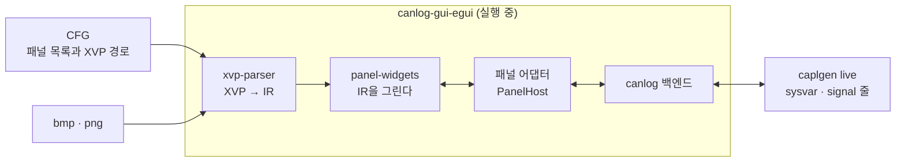

# 구현 검토 의견: capl_to_rust 구현자의 관점

작성일: 2026-10-14. 대상: [변환 검토서](xvp-to-egui-review.md)와 [개발 계획서](development-plan.md)(커밋 `ed56157`).

이 문서는 `capl_to_rust`(`caplgen`)를 구현해 온 쪽에서 두 문서를 읽고, 이 일을 맡아 구현하면 어떨지를 적은 것이다. 두 문서의 주장 가운데 확인할 수 있는 것은 같은 PC에서 다시 확인했고, `caplgen` 쪽 사정은 소스에서 확인했다. 코드는 아직 쓰지 않았다.

## 요약

구현할 수 있고 계획은 대체로 타당하다. 고칠 것은 세 가지다.

- **실행 중에 그리는 방식을 먼저 한다.** 계획은 코드를 생성해 canlog에 컴파일해 넣고, 실행 중에 XVP를 읽는 방식은 M8로 미뤘다. 순서를 뒤집기를 권한다. 계획의 `xvp-viewer`가 이미 그 렌더러이고, 문서가 꼽은 가장 큰 리스크(CFG와 패널의 불일치, 다시 빌드)가 없어진다.
- **첫 관통 단계에 스위치와 신호가 들어가야 한다.** M2의 완료 기준인 Easy 샘플의 두 패널은 기본 위젯만으로 그려지지 않는다. `SwitchControl`이 여섯 개, `AnalogGaugeControl`이 한 개 있고 바인딩 일곱 개 가운데 셋이 버스 신호다.
- **`caplgen` 쪽 일은 문서가 본 것보다 작다.** 신호 쓰기는 호스트에 이미 있고 `live`에 줄 하나를 더하면 된다. 구조체 멤버와 값 테이블도 이미 다룬다.

맡는다면 변환 툴 저장소와 `capl_to_rust` 쪽을 맡고, canlog 쪽 변경은 canlog를 작업하는 쪽과 나누는 것이 깔끔하다. 혼자 하기 어려운 것은 CANoe 화면이 필요한 일(비교용 캡처, 포맷의 추정 확인)이다.

## 다시 확인한 것

| 문서의 주장 | 확인 결과 |
| --- | --- |
| 내용이 다른 XVP는 764개 | 같다. `C:\Users\Public\Documents\Vector` 아래에서 1,523개를 찾았고 해시로 중복을 빼면 764개다 |
| canlog는 egui 0.36.2를 고정한다 | 같다. `gui/egui/Cargo.toml`에 `egui`, `eframe`, `egui_extras`, `egui_kittest`가 `=0.36.2`, `rust-version`은 1.95다 (canlog `e2cf5db`) |
| 같은 버전으로 빌드할 수 있다 | 이 PC의 cargo 캐시에 `egui`, `egui_kittest`, `egui-wgpu` 0.36.2와 `image` 0.25.10, `roxmltree`, `quick-xml`이 있다. 네트워크 없이도 빌드된다 |
| Panel Designer가 설치되어 있다 | `C:\Program Files\Vector CANoe 13.0\Exec64`에 `Vector.CANalyzer.Panels.*.dll`이 있다 |
| canlog는 이미지 디코더를 따로 둬야 한다 | canlog GUI의 `gui/egui/Cargo.lock`에 `image`와 `png`가 이미 있다. 새 의존성이 아니다 |

## capl_to_rust 쪽에서 본 정정

두 문서가 `caplgen`에 대해 적은 것 가운데 사정이 다른 것들이다. `capl_to_rust` 커밋 `bddd126` 기준이다.

| 항목 | 문서의 서술 | 실제 |
| --- | --- | --- |
| 신호 쓰기 | 통로가 없다. 두 저장소에 걸친 일이다 (M7, 규모 L) | 호스트에 `inject_il_signal`이 있고 `run`의 세션은 `signal` 입력을 받는다(`{"signal": {"name": "Console_1::WN_right_down", "raw": 1}}`). `live`가 그 줄을 받지 않을 뿐이다. `capl_to_rust` 쪽은 작은 일이다 |
| 구조체·배열 변수의 멤버 | 확인 필요 | 구조체 변수는 멤버마다 `NS::Var.Member` 변수로 풀려 있다. XVP의 종류 128(`GPS;;GPS1;Altitude`)은 `GPS::GPS1.Altitude`가 된다. 배열·문자열·데이터 변수는 `live`가 `values`, `text`, `data`로 주고받는다 |
| 시스템 변수의 값 테이블 | canlog의 `cfg_core`(`sysvar.rs`)로 읽을 수 있는지 확인한다 (M6) | `capl-model`의 `sysvars`가 vsysvar·XML의 `valuetable`을 이미 읽는다. `live`의 `ready.sysvars`에 실어 보내면 변환 시점이 아니라 실행 중에 얻는다 |
| 패널 조작 함수 | 지원하지 않는다 | `enableControl`, `putValueToControl`, `SetControlVisibility`, `SetControlBackColor`, `SetControlForeColor`, `setControlColors`, `SetControlProperty`는 아무 일도 하지 않는 stub으로 받는다(`CAPL-API-002` 경고). 스크립트의 변환은 막히지 않고 효과만 빠진다 |
| 환경 변수 | `caplgen`은 다루지만 `live`가 주고받는 줄에 없다 | `on envVar`, `getValue`, `putValue`가 구현되어 있고 환경 변수를 네임스페이스 없는 시스템 변수로 묶는다. 그렇다면 지금의 `sysvar` 줄로 될 수 있다. 그 이름이 `ready.sysvars`에 어떻게 나오는지는 확인하지 못했다 |
| CANoe의 include 폴더 | (언급 없음) | `caplgen`이 CANoe의 `Reusable\CAPL_Includes`를 스스로 찾는다(`bddd126`). canlog가 `--include-dir`를 주지 않아도 `CANSystemDemo`의 노드 8개가 모두 돈다 |

`live`에 더할 줄의 모양은 세션의 `signal` 입력과 같게 하는 것이 자연스럽다. 제안이다.

```text
in: {"signal": {"name": "LightState::HeadLight", "value": 1}}     물리 값
    {"signal": {"name": "LightState::HeadLight", "raw": 1}}       원시 값
```

쓴 신호가 버스에 나가는 조건은 문서가 적은 그대로다. 그 메시지를 보내는 노드가 `caplgen`에서 돌 때만 나간다.

## 계획에 대한 의견

### 1. 실행 중에 그리는 방식을 먼저

계획은 `XVP → IR → Rust 코드 → canlog에 컴파일`이고, 실행 중에 XVP를 읽는 방식은 미결 1번의 답에 따라 M8에 더한다고 했다. 다음 이유로 순서를 뒤집기를 권한다.

- **렌더러는 어차피 만든다.** M2의 `xvp-viewer`는 XVP를 컴파일 없이 그린다. IR을 받아 위젯을 부르는 그 코드가 실행 중 렌더러다. 코드 생성기(M3)는 같은 일을 한 번 더 하는 것이다.
- **가장 큰 리스크가 없어진다.** 검토서는 CFG와 패널의 불일치를 첫 리스크로 꼽았다. canlog가 CFG를 열 때 그 CFG가 가리키는 XVP를 읽으면 어긋날 수 없다. 패널을 고칠 때마다 canlog를 다시 빌드하는 일도 없다.
- **빌드 장치가 필요 없다.** 빈 패널 크레이트, 환경 변수로 폴더를 받는 빌드 스크립트, 사용자 PC의 Rust 도구가 빠진다.
- **CAPL 쪽과 같은 방향이다.** `caplgen live`는 빌드 없이 해석기로 노드를 돌린다. 구성을 열고 몇 초 안에 도는 것이 그 방식의 이점이었다. 패널만 빌드를 요구하면 그 이점이 반으로 준다.
- **대가는 작다.** 이미지 디코더가 필요하지만 canlog에는 `image`가 이미 있다. 값 테이블은 실행 중에 `caplgen`과 canlog가 준다.

코드 생성은 버리지 않는다. 사람이 고쳐 쓸 패널 코드가 필요해지면 같은 IR에서 낼 수 있다. 다만 첫 목표는 아니다.



이 방식에서는 `xvp-parser`도 canlog에 들어간다(`engines/panel/`). egui를 모르는 크레이트라서 부담은 XML 파서 하나다.

### 2. 첫 관통 단계에 스위치와 신호를 넣는다

계획의 M2 완료 기준은 "Easy 샘플의 Control·Display 패널이 뜨고 조작된다"이고, M2는 기본 위젯만 다룬다. 두 패널을 세어 보면 맞지 않는다.

| 패널 | 컨트롤 | 바인딩 |
| --- | --- | --- |
| Control | GroupBox 4, **Switch 3**, StaticText 2, TrackBar 1 | 시스템 변수 3, **신호 1**(`LightState::HeadLight`, 스위치로 쓴다) |
| Display | **Switch 3**, GroupBox 2, StaticText 2, **AnalogGauge 1**, PictureBox 1, TextBox 1 | 시스템 변수 2, **신호 2**(`EngineState::EngineSpeed`, `OnOff`) |

`CANSystemDemo`의 패널 10개도 같다. 컨트롤 218개 가운데 `SwitchControl`이 69개(32%)로 `StaticTextControl` 다음이고, 바인딩 111개 가운데 17개가 신호다.

그래서 첫 단계의 범위를 이렇게 잡기를 권한다.

- 위젯: 라벨, 그룹 박스, 텍스트 박스, 슬라이더, 이미지, **비트맵 스위치**, **아날로그 계기판**.
- 바인딩: 시스템 변수 읽기·쓰기, **신호 읽기**, **신호 쓰기**.

스위치의 비트맵 조각 규칙(`StateCnt + 1`, 첫 칸의 쓰임)은 계획이 M5에서 확인하기로 한 것인데, 이 범위에서는 처음에 확인해야 한다.

이 두 구성을 고르는 이유는 하나 더 있다. 둘 다 `caplgen live`로 도는 것을 확인했다. Easy는 엔진 스위치를 켜고 속도를 주면 노드가 그 값을 프레임에 싣고, `CANSystemDemo`는 점화와 시동 변수로 두 네트워크가 깨어난다. 패널을 붙이면 "패널 조작 → 변수 → 노드 → 프레임 → 패널 표시"가 한 바퀴 돈다.

### 3. 기본값 표는 읽는 속성만

계획은 관찰한 (종류, 속성) 430개를 모두 분류하고 31종의 기본값 표를 만든다. 순서를 바꾸기를 권한다. 위젯이 실제로 읽는 속성부터 기본값을 채우면 처음에 필요한 것은 수십 개다. 나머지는 IR에 원문으로 남아 있으므로 잃는 것이 없다.

기본값을 Vector의 DLL에서 읽는 것은 문서도 적었듯 라이선스 확인이 먼저다. 표가 숫자와 색 이름의 목록이라도, 출처를 적고 조건을 확인한 뒤에 저장소에 싣는다.

### 4. 시험

계획의 시험 전략에 더할 것은 그림 비교다. 검토서는 canlog의 `egui_kittest` 구성에 화면 이미지 비교가 없다고 했다. 변환 툴 저장소는 그 구성을 따를 필요가 없다. `egui-wgpu`와 `dify`가 캐시에 있으므로 이 저장소의 시험에서는 패널을 PNG로 떠서 기준 그림과 비교할 수 있다. 기준 그림은 Vector 샘플에서 나온 것이면 저장소에 넣지 않는다(환경 변수로 받는 폴더에 둔다).

`caplgen live`를 붙이는 시험은 `capl_to_rust`의 `apps/caplgen/tests/live.rs`가 쓰는 방식을 그대로 쓸 수 있다. 합성한 구성 설명으로 `live`를 띄우고 줄을 주고받는다. Vector 파일이 필요 없다.

## 맡을 때의 조건과 한계

| 항목 | 내용 |
| --- | --- |
| CANoe 화면이 필요한 일 | 비교용 캡처, `SymbolConfiguration` 종류 128 이상과 뒤쪽 필드의 의미, 스위치 비트맵 첫 칸의 쓰임은 CANoe에서 값을 바꿔 저장해 봐야 한다. CANoe 13.0은 설치되어 있으나 내가 그 화면을 조작할 수 있는지는 해 보지 않았다(라이선스 포함). 안 되면 캡처와 저장한 XVP를 받아야 한다 |
| 그린 결과의 확인 | 패널을 PNG로 떠서 직접 볼 수 있다. 배치, 넘침, 색은 그렇게 확인한다 |
| 화면 일치 수준 | Windows Forms와 픽셀까지 같게 하기는 어렵다. 검토서의 권고(배치와 동작은 같게, 위젯 모양은 egui)가 현실적이다 |
| canlog 저장소 | 다른 작업자가 있는 저장소다. 어댑터와 창 등록은 그쪽이 하거나, 내가 패치를 만들어 넘기는 방식이 맞다. 같은 파일을 두 쪽이 고치지 않게 한다 |
| Vector 파일 | 샘플 XVP와 비트맵, 그것으로 만든 스냅샷은 저장소에 넣지 않는다. `capl_to_rust`에서 지켜 온 규칙과 같다 |
| 작업량 | 대부분은 위젯을 그리는 일이다. 텍스트 박스의 표시 형식과, 작은 사각형에 위젯을 맞추는 일이 가장 손이 간다. 파서와 `live` 쪽 변경은 작다 |

## 제안하는 순서

계획의 M0~M8을 다음처럼 다시 묶는다. 위젯과 파서의 내용은 같고 순서와 묶음이 다르다.

| 단계 | 내용 | 저장소 |
| --- | --- | --- |
| A | 워크스페이스, 샘플 순회 시험(해시로 중복 제거), 파서와 IR, 집계 도구 (계획의 M0, M1) | 변환 툴 |
| B | `PanelHost`, 첫 범위의 위젯 일곱 종, IR을 그리는 렌더러, 뷰어. Easy의 두 패널이 가짜 값으로 뜬다 | 변환 툴 |
| C | `live`에 `signal` 줄, `ready.sysvars`에 값 테이블과 범위 | capl_to_rust |
| D | 뷰어를 `caplgen live`에 직접 붙인다. canlog 없이 "패널 → 변수·신호 → 노드 → 프레임 → 패널"이 돈다 | 변환 툴 |
| E | canlog 연동: `engines/panel/`, 어댑터, 패널 창. CFG의 패널 목록에서 XVP를 읽는다 | canlog |
| F | 나머지 위젯(버튼, 체크 박스, LED, 계기, 7세그먼트 등)을 실제 대상 패널의 집계 순서로 | 변환 툴 |
| G | CANoe 의존 컨트롤의 대체 동작, 패널 조작 함수, 필요하면 코드 생성 | 변환 툴, capl_to_rust |

D를 넣은 이유는 canlog를 기다리지 않고 끝까지 확인하기 위해서다. 뷰어가 `PanelHost`를 `live`의 줄로 구현하면, canlog의 어댑터가 할 일을 먼저 겪어 본다. 값의 지연과 변수 이름의 문제가 여기서 나온다.

## 결정이 필요한 것

1. **실행 중에 그리는 방식으로 가는가.** 검토서의 미결 1번이다. 이 문서의 권고는 "그렇다"이다. 답에 따라 계획의 M3과 M4의 모양이 바뀐다.
2. **누가 어느 저장소를 고치는가.** 변환 툴과 `capl_to_rust`를 한쪽이, canlog를 다른 쪽이 맡는 것을 권한다.
3. **CANoe 화면 캡처를 누가 준비하는가.** 내가 CANoe를 조작할 수 없으면 Easy의 두 패널과 `CANSystemDemo`의 패널부터 캡처가 필요하다.
4. **실제로 변환할 패널.** 검토서의 미결 5번과 같다. 받으면 A의 집계로 F의 순서를 정한다.

## 근거

- 두 문서: `panel_to_rust_egui` 커밋 `ed56157`.
- XVP 개수: `C:\Users\Public\Documents\Vector` 아래를 재귀로 찾아 SHA-1로 중복을 뺐다. Easy와 `CANSystemDemo`의 컨트롤·바인딩 개수는 그 패널들의 `Object`와 `SymbolConfiguration`을 세었다.
- canlog: `najari/codex_test` 커밋 `e2cf5db`의 `gui/egui/Cargo.toml`과 `gui/egui/Cargo.lock`.
- capl_to_rust: `najari/capl_to_rust` 커밋 `bddd126`. `apps/caplgen/src/live.rs`(주고받는 줄), `crates/capl-rt/src/host.rs`(`inject_il_signal`), `crates/capl-session/src/lib.rs`(`signal` 입력), `crates/capl-model/src/sysvars.rs`(값 테이블, 구조체 멤버), `crates/capl-model/src/bind.rs`(패널 함수 stub, `on envVar`·`getValue`·`putValue`), `apps/caplgen/src/canoeinc.rs`.
- `caplgen live`로 Easy와 `CANSystemDemo`를 돌린 결과: `capl_to_rust`의 `docs/implementation-status.ko.md`("`caplgen live`를 돌려 보고 고친 것")와 canlog 쪽 재검토 5(`retest5.ko.md`).
- 확인하지 못한 것: 환경 변수가 `live`의 줄에서 불리는 이름, CANoe 화면의 조작 가능 여부, egui 0.36.2에서 `egui_kittest`의 그림 비교가 이 PC에서 실제로 도는지(크레이트가 캐시에 있는 것만 확인했다).
