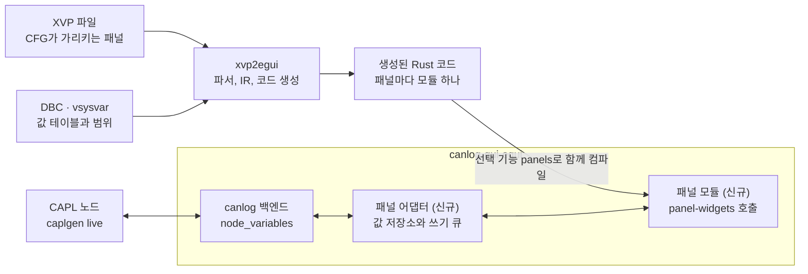

# CANoe XVP 패널 → Rust UI 변환 툴 검토서

검토일: 2026-10-14. 같은 날 재검토해 고쳤다(끝의 [개정 이력](#개정-이력)).

## 요약

변환 툴은 만들 수 있고, canlog에는 패널이 들어갈 자리가 이미 있다. canlog는 CAPL 노드의 시스템 변수를 읽고 쓰는 API를 갖고 있고, 지금은 그 값을 목록 창(Node variables)으로만 보여 준다. 변환된 패널이 그 창의 역할을 대신한다.

- **파싱은 쉽다.** XVP는 요소 세 가지로 된 XML이다. 검토한 PC의 샘플 764개(중복 제외)가 모두 같은 구조로 읽혔다.
- **컨트롤의 86%는 egui 기본 위젯을 바탕으로 만든다.** 샘플의 컨트롤 15,971개 기준이다. 12%는 처음부터 직접 그리고, 2%는 CANoe 기능에 묶여 있어 대체 동작을 정해야 한다. 기본 위젯도 그대로 놓기만 하면 되는 것은 아니다. 눈금 있는 슬라이더와 세로 진행 막대는 egui에 없다.
- **시스템 변수 연결은 canlog의 기존 API로 된다.** `node_variables`와 `set_node_variable`이 패널이 하는 일을 그대로 한다. 샘플 바인딩의 88%가 시스템 변수다.
- **신호는 읽기는 이미 되고 쓰기만 통로가 없다.** canlog의 Graph용 함수가 신호의 마지막 값과 값 테이블을 돌려준다. 쓰기는 `caplgen`에 Interaction Layer가 있지만 canlog에서 부를 통로가 없다.
- **egui 버전은 canlog에 맞춘다.** canlog GUI는 egui 0.36.2를 고정해서 쓴다. 위젯 라이브러리와 생성 코드도 같은 버전을 쓴다.
- **XVP에 없는 것이 두 가지 있다.** 저장되지 않은 속성의 기본값과, 콤보박스 항목·심볼 표시값이다. 기본값은 설치된 Panel Designer에서, 값 테이블은 DBC와 시스템 변수 정의에서 가져온다.

구조는 `XVP → 파서 → 중간 표현(IR) → Rust 코드 생성`이다. 생성 코드는 canlog GUI 크레이트에 선택 기능으로 컴파일해 넣는다. 패널 묶음이 바뀌면 다시 변환하고 canlog를 다시 빌드한다.

## XVP 파일 포맷 분석

XVP는 일반 XML이고 구조가 단순해서 파싱 자체는 어렵지 않다. 검토한 PC에서 찾은 XVP 1,526개를 전부 파싱했고 실패한 파일은 없다. 그중 내용이 서로 다른 파일은 764개다. 나머지는 CANoe·CANalyzer에 같이 들어 있는 샘플과 샘플 폴더의 복사본이다. 아래 수치는 모두 중복을 뺀 764개 기준이다.

### 구조

요소는 `Panel`, `Object`, `Property` 세 가지뿐이다. 최상위 `Panel` 아래에 `Object`가 트리로 중첩되고, 각 `Object`가 `Property`를 갖는다.

```xml
<Panel Type="Vector.CANalyzer.Panels.PanelSerializer, ..., Version=9.0.86.0, ...">
  <Object Type="Vector.CANalyzer.Panels.Runtime.Panel, ..." Name="Panel" Children="Controls">
    <Object Type="Vector.CANalyzer.Panels.Design.TrackBarControl, ..." Name="TrackBarControl1">
      <Property Name="Size">131, 47</Property>
      <Property Name="Location">6, 15</Property>
      <Property Name="Maximum">3500</Property>
      <Property Name="SymbolConfiguration">4;16;Engine;;;EngineSpeedEntry;2;;;-1</Property>
    </Object>
    <Property Name="Size">364, 107</Property>
  </Object>
</Panel>
```

- **컨트롤 종류는 `Type` 속성의 .NET 클래스 이름으로 구분한다.** 샘플 전체에서 패널 자신을 포함해 32종이 나온다. 설치된 Panel Designer 13.0에는 샘플에 없는 컨트롤이 두 종 더 있다(`ClinometerControl`, `MediaStreamControl`).
- **좌표는 부모 기준 픽셀이다.** `Location`은 부모 컨테이너 안에서의 위치다. 중첩 깊이는 최대 6단계였다.
- **기본값과 같은 속성은 저장되지 않는다.** 예를 들어 `TrackBarControl` 435개 중 `Minimum`이 있는 것은 225개다. 빠진 속성의 값은 샘플에서 알 수 없다.
- **기본값은 설치된 Panel Designer에서 읽을 수 있다.** 컨트롤 클래스의 속성에 기본값이 형식 정보로 붙어 있다. `TrackBarControl`은 `Minimum` 0, `Maximum` 10, `TickFrequency` 1, `LargeChange` 5였고, `ButtonControl`은 누를 때 1, 뗄 때 0이었다. 속성 이름이 XVP와 다른 경우가 있어(`ControlBackColor`와 `BackColor`) 대응표가 필요하다.
- **값은 모두 문자열이다.** 색은 `221, 221, 221` 또는 `Window`, `LightYellow` 같은 .NET 색 이름이다. 글꼴은 `Arial, 10pt, style=Bold` 형식이다.
- **이미지는 상대 경로 참조다.** 1,856건 중 bmp 1,237건, png 597건, jpg 18건, gif 4건이다. `PanelHelpControl`만 base64 PNG를 파일 안에 담는다.

### 파일 규모와 버전

패널 하나의 컨트롤 수는 중앙값 11개, 상위 10% 지점 40개, 최대 623개다. 직렬화 버전은 7부터 13까지 섞여 있고 모두 같은 구조로 읽힌다. 버전 표기가 1인 파일이 하나 있다. CANoe 14 이상에서 저장한 파일은 검토한 PC에 없어서 확인하지 못했다.

### 심볼 바인딩: SymbolConfiguration

컨트롤이 어떤 값에 연결되는지는 `SymbolConfiguration` 한 줄에 세미콜론으로 담긴다. 객체 16,735개(패널 764개 포함) 중 8,670개가 이 속성을 갖는다. `CompassControl`만 `SymbolConfiguration1`, `SymbolConfiguration2` 두 개를 쓴다.

첫 필드는 형식 버전(1~6), 둘째 필드는 심볼 종류다. 이어지는 네 필드가 이름 경로다. 버전이 올라갈수록 뒤에 필드가 붙어 6개에서 14개까지 길이가 다르다.

| 종류 코드 | 의미 | 건수 | 예시 |
| --- | --- | --- | --- |
| 16 | 시스템 변수 | 7,645 | `4;16;Engine;;;EngineSpeedEntry;2;;;-1` |
| 2 | 버스 신호 (DB; 노드; 메시지; 신호; …; 채널) | 517 | `4;2;easy;Light;LightState;HeadLight;0;easy;;-1` |
| 128 | 구조체·배열 시스템 변수의 멤버 | 205 | `5;128;GPS;;GPS1;Altitude;2;;;-1;;;` |
| 1 | 환경 변수 | 135 | `1;1;;;;evImageIndex` |
| 256, 512, 1024, 4096 | 서비스 신호, 통신 객체(SOME/IP 등) | 112 | `6;4096;ClimateSimulation::FanSimulation;Fan1.ProvidedRotationSpeed;;1;512;;;-1;;;;` |
| 비어 있음 | 연결 없음 | 56 | |

종류 코드의 의미는 Vector 공식 문서가 아니라 샘플 값에서 역으로 추정한 것이다. 1, 2, 16은 이름 패턴이 분명하다. 128 이상과 7번째 이후 필드는 CANoe에서 값을 바꿔 저장해 보며 확인해야 한다.

### 상태 값 인코딩

스위치류는 값과 상태의 대응을 별도 문자열로 저장하고, 버전에 따라 형식이 세 가지다.

- `SwitchValues`: `1;2;0;1`. 버전, 상태 수, 상태별 값 순이다.
- `SwitchValuesRx`: `1;9;[0..50];[51..60];…`. 표시할 때 쓰는 값 범위다.
- `SwitchValuesVT`: `0/Lower/0;1/Lower/1` 형식과 `<Version>2</Version><Count>2</Count><RxValue>…` 형식이 함께 쓰인다.

스위치 비트맵은 상태별 그림을 가로로 이어 붙인 한 장이고, 조각 수는 `StateCnt + 1`로 보인다. 디스크에 이미지가 있는 스위치 1,360개에서 조각 하나의 가로세로 비를 컨트롤의 비와 견주면, `StateCnt + 1`로 나눌 때가 더 가까운 것이 1,307개(96%), `StateCnt`로 나눌 때가 더 가까운 것이 35개, 구분되지 않는 것이 18개다. 직접 열어 본 한 장(상태 2개)은 그림이 세 칸이었고 첫 칸과 둘째 칸이 같은 그림이었다.

남은 확인 사항은 두 가지다. 첫 칸의 쓰임(정의되지 않은 값일 때 그리는 것으로 추정)과, 너비가 조각 수로 나누어떨어지지 않는 96개의 반올림 방식이다.

## 대상 프레임워크: canlog의 egui

대상은 canlog GUI가 쓰는 egui 0.36.2다. canlog의 `gui/egui` 크레이트가 egui, eframe, egui_extras를 `=0.36.2`로 고정하고 있어서 변환 결과도 같은 버전에 맞춘다. 버전이 다르면 한 실행 파일에 egui가 두 벌 들어가 타입이 맞지 않는다.

egui는 매 프레임 UI 전체를 다시 그리는 즉시 모드(immediate mode) 라이브러리다. 패널처럼 값이 계속 바뀌는 화면에 잘 맞는다. 값이 바뀌면 다음 프레임에 그대로 반영되므로 별도의 갱신 이벤트 배선이 필요 없다.

패널 변환에서 중요한 egui 특성은 세 가지다. API 이름은 egui 0.36.2 소스에서 확인했다.

- **절대 좌표 배치가 가능하다.** XVP는 모든 컨트롤을 `Location`과 `Size` 픽셀 값으로 저장한다. `ui.place(rect, widget)`은 배치 커서를 움직이지 않고 지정한 사각형에 위젯을 놓는다. 그룹 박스 같은 컨테이너는 `ui.scope_builder(UiBuilder::new().max_rect(rect), …)`로 자식 영역을 만든다.
- **위젯은 사각형을 그대로 채우지 않는다.** `place`는 위젯을 사각형 가운데에 놓는다. 위젯의 최소 크기가 사각형보다 크면 넘칠 수 있다. XVP의 크기와 글꼴에 맞추려면 위젯마다 여백과 크기를 조정해야 한다.
- **커스텀 그리기가 쉽다.** 계기판, LED, 비트맵 스위치처럼 기본 위젯에 없는 컨트롤은 `Painter`로 직접 그린다.

canlog에 맞춰야 하는 것은 네 가지다.

- **창.** canlog는 떠 있는 창(`egui::Window`)과 도킹(`egui_tiles`)을 함께 쓴다. 패널은 크기가 고정이므로 떠 있는 창으로 먼저 넣는다.
- **테마.** canlog는 밝은 테마와 어두운 테마를 바꾼다. 패널 안쪽은 XVP에 저장된 색을 그대로 쓰므로 테마를 따르지 않는다.
- **글꼴.** egui의 기본 글꼴은 Ubuntu Light이고, canlog는 한글용으로 그 뒤에 맑은 고딕을 붙인다. 그대로 두면 XVP가 지정한 Microsoft Sans Serif와 Arial 자리에 이 글꼴이 쓰여 글자 폭이 달라진다. canlog가 맑은 고딕을 Windows 글꼴 폴더에서 읽는 것과 같은 방식으로 `micross.ttf`와 `arial.ttf`를 읽어 패널 전용 글꼴로 등록하면 차이를 줄일 수 있다.
- **테스트.** canlog GUI는 `egui_kittest`로 화면을 시험한다. 패널도 같은 도구로 시험한다.

## 컨트롤 매핑

샘플에 나온 컨트롤 31종은 세 묶음으로 나뉜다. egui 기본 위젯을 바탕으로 만드는 13종이 13,732개(86%), 처음부터 직접 그리는 9종이 1,905개(12%), CANoe 기능에 묶인 9종이 334개(2%)다.

| 컨트롤 | 개수 | egui 대응 | 묶음 |
| --- | --- | --- | --- |
| StaticTextControl | 4,663 | `Label` | 기본 |
| TextBoxControl | 2,731 | `TextEdit` + 설명 라벨. 표시 형식(10진, 16진, 심볼)과 경보 색 처리 필요 | 기본 |
| GroupBoxControl | 1,909 | 제목이 테두리에 걸치는 프레임. `Frame` + 제목 그리기 | 기본 |
| SwitchControl | 1,530 | 비트맵 조각을 상태에 따라 바꾸는 이미지 위젯 | 커스텀 |
| ButtonControl | 1,523 | `Button`. 누를 때와 뗄 때 값을 따로 보냄 | 기본 |
| CheckBoxControl | 1,085 | `Checkbox` | 기본 |
| RadioButtonControl | 525 | `RadioButton` | 기본 |
| TrackBarControl | 435 | `Slider`(세로 지원). 눈금과 최소·최대 표시는 egui에 없어 직접 그림 | 기본 |
| PictureBoxControl | 342 | `Image` | 기본 |
| ComboBoxControl | 237 | `ComboBox`. 항목은 XVP에 없고 값 테이블에서 가져옴 | 기본 |
| LEDControl | 163 | 원, 사각형, 삼각형을 `Painter`로 그림 | 커스텀 |
| PanelHelpControl | 153 | 도움말 파일을 여는 버튼 | CANoe 의존 |
| ProgressBarControl | 104 | 가로는 `ProgressBar`. 세로와 기준값은 egui에 없어 직접 그림 | 기본 |
| PanelButtonControl | 100 | 다른 패널을 여는 버튼. 앱 안의 창 전환으로 대체 | CANoe 의존 |
| VectorTabControl, VectorTabPage | 99 | 탭 줄 + 페이지 전환 | 기본 |
| HexEditorControl | 82 | 바이트 배열 편집기 | 커스텀 |
| NumericUpDownControl | 79 | `DragValue` | 기본 |
| MeterControl | 50 | 바늘 계기. 눈금 속성이 없어 배경 이미지 위에 바늘만 그리는 것으로 추정 | 커스텀 |
| LCDControl, ClockControl | 42 | 7세그먼트 숫자 그리기 | 커스텀 |
| CAPLOutputViewControl | 36 | CAPL 출력을 보여 주는 텍스트 영역 | CANoe 의존 |
| AnalogGaugeControl | 28 | 눈금과 색 구간이 있는 계기판 | 커스텀 |
| PathControl | 19 | 파일 선택 대화상자 | CANoe 의존 |
| LEDBand, CompassControl | 10 | 직접 그리기 | 커스텀 |
| StartStop, FunctionMethod, Nm, MOSTButton, MediaPlayer | 26 | 측정 시작·정지 등 CANoe 전용 기능 | CANoe 의존 |

이 비율은 Vector 샘플 기준이다. 실제로 변환할 패널에 같은 집계를 돌려야 우선순위가 정해진다.

모든 컨트롤에 공통으로 필요한 변환은 다음과 같다.

- **글꼴 크기.** XVP는 pt 단위고 egui는 픽셀 단위다. 96 DPI 기준 8.25pt는 11px다. 가장 많이 쓰이는 글꼴은 Microsoft Sans Serif와 Arial이다.
- **색 이름.** `Window`, `Info`, `WhiteSmoke` 같은 .NET 색 이름을 RGB로 바꾸는 표가 필요하다.
- **투명색.** `TransparentColor`로 지정한 색(Magenta, `3, 2, 1` 등)을 알파로 바꾼다.
- **읽기 전용.** `ReadOnlyControl`이 켜진 컨트롤은 표시만 하고 값을 쓰지 않는다.

## 변환 툴 아키텍처

변환 툴은 이 저장소(`panel_to_rust_egui`)에서 만들고, canlog는 그 결과물만 받는다. canlog가 capl_to_rust의 `caplgen`을 쓰는 것과 같은 관계다.

canlog에 새로 들어가는 것은 패널 모듈과 패널 어댑터 둘이다.



윗줄은 빌드 전에 한 번 도는 변환이고, 아랫줄은 canlog가 실행되는 동안 값이 오가는 길이다. CAPL 노드와 canlog 백엔드는 이미 있다.

| 구성 요소 | 두는 곳 | 역할 |
| --- | --- | --- |
| `xvp-parser` | 변환 툴 저장소 | XVP → IR. 기본값 채우기, 색·글꼴·심볼 문자열 해석, 모르는 속성 보고 |
| `xvp2egui` | 변환 툴 저장소 | IR → Rust 소스. 패널마다 모듈 하나, 이미지 변환, 패널 목록 생성 |
| `xvp-viewer` | 변환 툴 저장소 | XVP를 컴파일 없이 바로 그리는 검증용 앱. 가짜 값으로 동작 |
| `panel-widgets` | 변환 툴 저장소에서 개발, canlog의 `engines/panel/`에 복사 | egui 위젯 22종, `PanelHost` 트레이트. egui 외에는 의존하지 않는다 |
| 생성된 패널 코드 | canlog 밖의 폴더 (미결 사항 2번) | `xvp2egui`의 출력. `panel-widgets`만 쓴다 |
| 패널 크레이트 | canlog 저장소 안 | 생성된 코드를 받아 포함하는 빈 크레이트. 코드가 없으면 패널 0개로 빌드된다 |
| 패널 어댑터 | canlog `gui/egui/src/files/` | `PanelHost`를 canlog 백엔드로 구현. View 메뉴와 창 등록 |

이미지는 변환 시점에 풀어서 넣는다. 샘플 이미지의 67%가 bmp인데 egui는 이미지 파일을 스스로 읽지 못한다. `xvp2egui`가 이미지를 읽어 투명색을 알파로 바꾸고 생성 코드에 픽셀 데이터로 넣으면, `panel-widgets`는 이미지 디코더 없이 egui만으로 그릴 수 있다.

### canlog에 붙이는 방식

- **선택 기능으로 넣는다.** `gui/egui`에 `panels` 기능을 더하고 `scripts/build.ps1`에 스위치를 더한다. `cdd`, `canoe-cfg`, `vector-xl`과 같은 방식이다. 기능을 끄면 canlog는 지금과 같다.
- **생성 코드는 경로 의존성으로 직접 걸 수 없다.** Cargo는 선택 의존성이라도 그 폴더의 `Cargo.toml`을 읽으려 하므로, 폴더가 없으면 기능을 꺼도 빌드가 실패한다(시험으로 확인). 그래서 canlog 안에 빈 패널 크레이트를 두고, 그 크레이트의 빌드 스크립트가 환경 변수로 받은 폴더의 생성 코드를 포함하게 한다. 변수가 없으면 패널 0개로 빌드된다. 이 방식도 작은 시험으로 동작을 확인했다.
- **엔진 규칙을 따른다.** canlog는 외부 엔진 소스를 `engines/<이름>/crates`에 복사하고 `manifest.json`에 출처 커밋과 해시를 적는다. `panel-widgets`도 그렇게 넣는다.
- **본체 변경을 작게 유지한다.** `files/ui.rs`는 11,228줄이다. 패널 창은 `files/nodes.rs`의 Node variables 창과 같은 모양으로 별도 파일에 두고 `ui.rs`에는 호출만 더한다.
- **변환 대상은 CFG에서 뽑는다.** canlog의 CFG 엔진은 CFG에 등록된 패널과 XVP 경로를 이미 읽는다(`cfg_core`의 `tdp.rs`). 그 목록을 `xvp2egui`의 입력으로 쓴다.

### 설계 원칙

- **IR은 정보를 버리지 않는다.** 해석하지 못한 속성도 원문 그대로 IR에 남긴다. 포맷 이해가 늘면 파서만 고치면 된다.
- **생성 코드는 사람이 읽고 고칠 수 있어야 한다.** XVP의 컨트롤 이름을 식별자로 쓰고 좌표와 범위는 숫자 그대로 적는다.
- **다시 생성해도 손으로 쓴 코드가 지워지지 않는다.** 생성 파일과 사용자가 쓰는 파일을 분리하고, 생성 파일만 덮어쓴다.
- **배치는 절대 좌표를 유지한다.** 패널의 `IsProportional`이 켜진 경우에만 창 크기에 맞춰 전체를 비율로 늘린다.

## 런타임과 값 연결

변환된 패널은 canlog 백엔드에 이미 있는 함수로 값을 주고받는다. canlog 코드는 `set_node_variable`을 "CANoe의 패널이 하듯 시스템 변수를 쓴다"고 설명하고, GUI 문서는 "패널(.xvp)은 그리지 않는다. 시스템 변수의 목록이 그 대신이다"라고 적고 있다.

| 패널의 바인딩 | 샘플 비중 | canlog에서 읽기 | canlog에서 쓰기 |
| --- | --- | --- | --- |
| 시스템 변수 | 88% | `node_variables` | `set_node_variable`. int, int64, float, str 형만 |
| 버스 신호 | 6% | `graph_range`가 신호마다 마지막 값, 원시 값, 값 테이블 글자, 범위를 돌려준다. 한 번에 256개까지 | 통로 없음. `caplgen`에 Interaction Layer는 있으나 `caplgen live`가 받는 줄에 신호 쓰기가 없다 |
| 구조체·배열 시스템 변수의 멤버 | 2% | 확인 필요. `caplgen`은 문자열·데이터·배열 변수를 다룬다 | 확인 필요. canlog는 위 네 형만 쓴다 |
| 환경 변수 | 2% | 확인 필요. `caplgen`은 환경 변수를 다루지만 `caplgen live`가 주고받는 줄에는 없다 | 확인 필요 |
| 서비스 신호, 통신 객체 | 1% | 범위 밖 | 범위 밖 |

조건이 세 가지 있다.

- **빌드.** `node_variables`와 `set_node_variable`은 CAPL 노드가 도는 온라인 세션에서만 동작한다. canlog를 `-Cfg -Vector`로 빌드해야 하고, Windows와 Vector 드라이버, `caplgen.exe`가 필요하다.
- **세션이 없을 때.** 그런 세션이 없으면 `This session runs no CAPL nodes` 오류가 온다. 패널은 그때 비활성으로 표시한다.
- **신호 쓰기의 한계.** 통로를 내도, 쓴 신호는 그 메시지를 보내는 노드가 `caplgen`에서 돌 때만 버스에 나간다. 실제 ECU가 보내는 신호는 표시만 된다. CANoe도 같다.

### 런타임 구조

- **`PanelHost` 트레이트.** `panel-widgets`가 정의하고 canlog가 구현한다. 심볼 이름으로 값을 읽고 쓰는 두 동작이 전부다. 위젯 라이브러리는 canlog를 모르므로 뷰어에서 가짜 값으로 같은 코드를 돌린다.
- **시스템 변수 읽기.** `caplgen`은 변수가 바뀔 때마다 canlog에 알리고, canlog는 그 값을 메모리에 둔다. `node_variables`는 그 메모리를 읽는 함수라서 자주 불러도 다른 프로세스를 기다리지 않는다. Node variables 창의 0.3초 주기는 창이 고른 값이다. 패널은 이 주기를 줄여 쓴다. 값이 바뀐 호출은 변수 전체를 복사해 돌려주므로 변수가 많을 때의 비용은 측정한다.
- **신호 읽기.** `graph_range`는 세션 저장소에서 읽고, 다음 호출은 그 뒤에 들어온 행만 읽는다. 저장소에 값이 들어가기까지의 지연은 측정한다.
- **값 쓰기.** 패널이 이번 프레임에 쓸 값의 목록을 돌려주고, canlog가 작업 스레드에서 `set_node_variable`을 부른다. Node variables 창이 지금 하는 방식 그대로다.
- **값 테이블.** 신호의 값 테이블은 canlog가 실행 중에 돌려준다. 시스템 변수의 값 테이블은 변환 시점에 시스템 변수 정의에서 읽어 생성 코드에 넣는다. canlog의 CFG 엔진(`sysvar.rs`)을 그 용도로 쓸 수 있는지 먼저 확인한다.

### 생성 코드의 모양

`TrackBarControl` 하나가 다음과 같은 코드가 된다. 좌표와 범위, 심볼 이름은 XVP에서 그대로 온다. 위젯 API는 이 프로젝트가 정하는 것이라 이름은 예시다.

```rust
// Control.xvp → control.rs
pub fn draw(ui: &mut egui::Ui, host: &mut dyn PanelHost) {
    let o = ui.min_rect().min; // 패널 원점
    GroupBox::new("Speed").show(ui, rect(o, 74, 19, 143, 68), |ui, o| {
        TrackBar::new(sysvar("Engine::EngineSpeedEntry"))
            .range(0.0..=3500.0)
            .tick(500.0)
            .show_min_max(true)
            .show(ui, host, rect(o, 6, 15, 131, 47));
    });
}
```

canlog는 시스템 변수를 `네임스페이스::이름` 한 줄로 부른다. XVP는 네임스페이스와 이름을 따로 저장하므로 변환기가 합쳐서 적는다. 신호는 canlog가 `채널:…:ID:…` 형식의 키로 부르고, 이름·채널·CAN ID로 찾는다. XVP의 (DB, 노드, 메시지, 신호, 채널)을 이 키로 바꾸는 규칙이 필요하다.

## 리스크와 한계

가장 큰 리스크는 컴파일해 넣는 방식 자체에서 나온다. canlog는 CFG를 실행 중에 여는데 패널은 빌드할 때 정해지므로, 연 CFG와 들어 있는 패널이 어긋날 수 있다.

| 리스크 | 내용 | 대응 |
| --- | --- | --- |
| CFG와 패널의 불일치 | 패널을 만든 CFG가 아닌 다른 CFG를 열면 패널이 찾는 변수가 세션에 없다 | 생성 코드에 원본 XVP의 해시와 필요한 변수 목록을 적는다. 세션에 없는 변수에 묶인 컨트롤은 비활성으로 표시한다 |
| 다시 빌드 | 패널을 고치거나 더할 때마다 변환과 canlog 빌드를 다시 해야 한다 | 변환과 빌드를 한 명령으로 묶는다. 패널을 자주 바꾼다면 미결 사항 1번을 다시 본다 |
| 기본 위젯의 크기 | egui 위젯은 지정한 사각형을 그대로 채우지 않는다. 작은 컨트롤에서 글자나 위젯이 넘칠 수 있다 | 위젯마다 여백과 최소 크기를 조정한다. 화면 비교로 넘침을 걸러 낸다 |
| 기본값의 출처 | 저장되지 않은 속성의 값은 설치된 Panel Designer의 형식 정보에서만 확인된다 | CANoe 13.0 설치본에서 읽어 표로 만든다. 표를 저장소에 싣기 전에 라이선스 조건을 확인한다. 다른 버전의 기본값이 같은지는 확인하지 못했다 |
| CAPL 패널 함수 | capl_to_rust는 `enableControl`, `putValueToControl` 같은 패널 조작 함수를 지원하지 않는다. 노드가 이 함수로 패널을 바꾸는 동작은 빠진다 | 패널에 컨트롤 이름으로 접근하는 API를 두고, `caplgen`이 그 호출을 내보내게 하는 일은 뒤 단계로 둔다 |
| 신호 쓰기 | 신호에 묶인 컨트롤(샘플의 6%)로 값을 쓰는 통로가 canlog와 `caplgen live` 사이에 없다 | 읽기 전용으로 먼저 표시한다. 필요하면 두 저장소에 통로를 더한다 |
| 값의 지연 | 시스템 변수는 메모리에서 읽지만 변수 전체를 복사한다. 신호는 세션 저장소를 거친다 | 변수 수에 따른 비용과 신호의 지연을 측정한다. 열려 있는 패널이 있을 때만 자주 읽는다 |
| egui 버전 동기화 | canlog가 egui를 올리면 `panel-widgets`도 같이 올려야 한다. egui는 마이너 버전마다 API가 바뀔 수 있다 | 생성 코드는 egui를 직접 부르지 않고 위젯 라이브러리만 부른다. 고칠 곳이 한 크레이트로 모인다 |
| 포맷 문서 없음 | `SymbolConfiguration`과 상태 값 문자열의 의미는 추정이다 | 모르는 필드는 버리지 않고 IR에 원문으로 보존한다. CANoe에서 값을 바꿔 저장해 차이를 확인한다 |
| 검증 안 된 버전 | 직렬화 버전 7~13만 확인했다. CANoe 14 이상 파일과 구형 패널 편집기 형식은 보지 못했다 | 알 수 없는 컨트롤과 속성은 오류로 멈추지 않고 보고서로 남긴다 |
| 화면 차이 | Windows Forms와 egui는 글꼴 렌더링, 테두리, 위젯 모양이 다르다 | 목표 수준을 먼저 정한다. 같은 글꼴 파일을 쓰고, CANoe 화면 캡처와 나란히 비교한다 |
| 없는 이미지 | 샘플에서 이미지 참조 1,856건 중 7건은 파일이 없었다 | 빈 자리 표시로 그리고 보고서에 기록한다 |
| 배포물 | Vector 샘플의 XVP와 비트맵은 Vector 소유다 | 테스트 입력으로만 쓰고 저장소와 배포물에는 넣지 않는다 |

변환기가 하지 않는 일도 분명히 한다. CAPL 변환은 capl_to_rust의 일이다. ActiveX·.NET 사용자 컨트롤과 DLL로 구현된 패널은 범위 밖이다.

## 구현 계획

단계별 작업과 완료 기준은 [개발 계획서](development-plan.md)에 있다. 순서만 적는다.

기본 위젯만으로 canlog까지 한 번 관통한 뒤에 컨트롤 종류를 늘린다. 붙이는 자리에서 생기는 문제(값의 지연, 변수 이름, 빌드 절차)를 일찍 찾기 위해서다.

1. 준비, 파서와 IR
2. 기본 위젯과 뷰어
3. 코드 생성기
4. canlog 연동 (시스템 변수)
5. 커스텀 위젯, 값 테이블, 신호 바인딩
6. 나머지

## 미결 사항

값의 출처, 결과물 형태, 실행 환경은 canlog로 정해졌다. 남은 것 중 1번과 2번은 canlog 연동 전에 정해야 한다.

1. **패널 묶음은 하나로 고정인가, CFG마다 다른가?** 컴파일해 넣는 방식은 묶음이 바뀔 때마다 canlog를 다시 빌드한다. 한 프로젝트의 패널만 쓴다면 문제가 없다. 여러 CFG를 오가며 쓴다면 canlog가 XVP를 실행 중에 읽어 그리는 방식이 더 맞다. 두 방식은 파서와 위젯을 공유하므로 컴파일 방식으로 시작해도 나중에 더할 수 있다.
2. **생성된 코드를 어디에 두는가?** 권고는 canlog 저장소 밖의 폴더에 생성하고, canlog 안의 빈 패널 크레이트가 환경 변수로 그 폴더를 받는 것이다. 패널은 프로젝트 자료라서 canlog 저장소에 커밋하면 도구와 자료가 섞인다.
3. **신호에 묶인 컨트롤로 값을 써야 하는가?** 읽기는 지금 있는 함수로 된다. 쓰기가 필요하면 canlog와 `caplgen` 쪽에 통로를 더해야 한다.
4. **화면을 어느 정도까지 똑같이 맞추는가?** 권고는 배치와 동작은 동일, 위젯 모양은 egui 스타일이다. 픽셀 단위 일치가 목표면 기본 위젯도 직접 그려야 해서 작업이 커진다.
5. **실제로 변환할 패널은 어떤 것인가?** CANoe 버전, 패널 수, 쓰인 컨트롤에 따라 우선순위가 바뀐다. 대상 CFG와 패널 폴더가 있으면 샘플에 한 것과 같은 집계를 돌릴 수 있다.
6. **CAPL 노드가 패널 조작 함수를 얼마나 쓰는가?** 많이 쓴다면 capl_to_rust 쪽 작업이 이 툴보다 먼저 필요할 수 있다.
7. **로그 재생에서도 패널을 쓸 것인가?** 이 검토는 CAPL 노드가 도는 온라인 세션만 다뤘다. canlog는 로그에 기록된 시스템 변수와 신호 값도 돌려주므로(`sysvars`, `graph_range`), 재생 위치의 값을 보여 주는 읽기 전용 패널이 가능하다. 필요하면 범위에 넣는다.

## 근거 자료

- 샘플 XVP: 검토한 PC의 `C:\Users\Public\Documents\Vector` 아래 CANoe·CANalyzer 13.0 샘플 구성과 `py-canoe-demo`의 Easy 샘플. 찾은 파일은 1,526개이고 내용이 서로 다른 것은 764개다. XVP에 관한 개수와 비율은 모두 764개를 파싱해 얻었다. 샘플 파일은 저장소에 넣지 않았다.
- 기본값: CANalyzer 13.0 설치본의 `Vector.CANalyzer.Panels.CommonControls.dll`에서 속성의 형식 정보만 읽었다. `TrackBarControl`과 `ButtonControl` 두 종만 확인했다.
- egui: 0.36.2 소스(`ui.rs`, `widgets/slider.rs`, `widgets/progress_bar.rs`)에서 API를 확인했다. 최신 버전 0.36.2, 2026-09-08 게시: [crates.io](https://crates.io/crates/egui). canlog가 고정한 버전과 같다.
- canlog(`najari/codex_test`, 커밋 `31ebd28`)에서 확인한 파일: `gui/egui/Cargo.toml`(egui 버전, 선택 기능), `gui/core/src/backend.rs`(`node_variables`, `set_node_variable`, `graph_range`, `sysvars`), `gui/egui/src/files/nodes.rs`(Node variables 창), `gui/egui/src/files/panels.rs`(신호 키), `gui/egui/src/fonts.rs`, `src/transport/nodes.rs`(변수 형과 쓰기), `engines/cfg/crates/cfg_core/src/tdp.rs`(CFG의 패널 목록), `engines/cfg/manifest.json`(엔진 규칙), `docs/gui.ko.md`.
- capl_to_rust(`najari/capl_to_rust`, 커밋 `e238e0e`): `apps/caplgen/src/live.rs`(주고받는 줄), `docs/capl-to-rust-conversion-review.ko.md`(패널 함수, 신호·환경 변수 변환).
- Cargo 동작: 없는 폴더를 가리키는 선택 경로 의존성이 기능을 꺼도 빌드를 막는 것, 빌드 스크립트로 바깥 폴더의 코드를 포함하는 것을 각각 작은 크레이트로 시험했다.
- `SymbolConfiguration` 종류 코드, 상태 값 형식, 비트맵 조각 규칙은 공식 문서가 아닌 샘플 관찰에서 나온 추정이다. 공개된 XVP 파서나 포맷 명세는 검색에서 찾지 못했다.
- 이 문서는 검토와 설계안이다. 여기에 적은 크레이트와 canlog 쪽 변경은 아직 구현되지 않았다.

## 개정 이력

2026-10-14 재검토에서 고친 것이다.

| 항목 | 이전 | 고친 내용 |
| --- | --- | --- |
| 샘플 수 | 1,526개 | 내용이 다른 파일은 764개. 복사본 폴더가 섞여 모든 개수가 약 두 배였다. 비율은 거의 같다 |
| egui API | `ui.allocate_ui_at_rect` | 0.36.2에 없는 함수였다. `ui.place`, `ui.scope_builder`로 고쳤다 |
| 기본 위젯 | 13종이 기본 위젯으로 옮겨진다 | 슬라이더 눈금과 세로 진행 막대는 egui에 없다. 위젯 크기 조정이 필요하다 |
| 글꼴 | 맑은 고딕으로 대체된다 | egui 기본 글꼴은 Ubuntu Light다. 원래 글꼴 파일을 읽어 쓰는 방법을 더했다 |
| 신호 읽기 | 새 백엔드 함수가 필요하다 | `graph_range`가 마지막 값과 값 테이블을 이미 돌려준다 |
| 갱신 주기 | 다른 프로세스에서 값이 와서 0.3초 주기가 문제다 | 값은 canlog 메모리에 있고 0.3초는 창이 고른 주기다 |
| 생성 코드 위치 | canlog가 경로로 참조한다 | 그 방식은 폴더가 없으면 빌드가 실패한다. 빈 패널 크레이트 방식으로 고쳤다 |
| 이미지 | 위젯 라이브러리의 이미지 로더 | 변환 시점에 풀어서 넣는다 |
| 기본값 | 컨트롤별 기본값 표가 필요하다 | 출처(설치된 Panel Designer)를 확인해 적었다 |
| 스위치 비트맵 | 나누어떨어지는지로 판단 | 조각의 가로세로 비로 다시 확인했다 |
