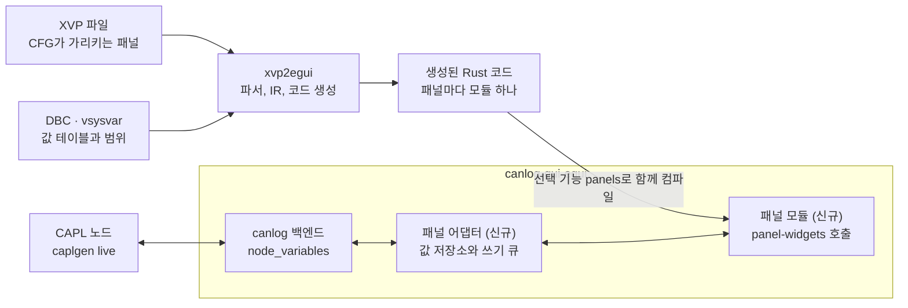

# CANoe XVP 패널 → Rust UI 변환 툴 검토서

검토일: 2026-10-14

## 요약

변환 툴은 만들 수 있고, canlog에는 패널이 들어갈 자리가 이미 있다. canlog는 CAPL 노드의 시스템 변수를 읽고 쓰는 API를 갖고 있고, 지금은 그 값을 목록 창(Node variables)으로만 보여 준다. 변환된 패널이 그 창의 역할을 대신한다.

- **파싱은 쉽다.** XVP는 요소 세 가지로 된 XML이다. 검토한 PC의 샘플 1,526개가 모두 같은 구조로 읽혔다.
- **컨트롤의 86%는 egui 기본 위젯으로 옮겨진다.** 샘플의 컨트롤 32,113개 기준이다. 12%는 직접 그리는 커스텀 위젯이 필요하고, 2%는 CANoe 기능에 묶여 있어 대체 동작을 정해야 한다.
- **값 연결은 canlog의 기존 API로 된다.** `node_variables`와 `set_node_variable`이 패널이 하는 일을 그대로 한다. 샘플 바인딩의 87%가 시스템 변수다.
- **egui 버전은 canlog에 맞춘다.** canlog GUI는 egui 0.36.2를 고정해서 쓴다. 위젯 라이브러리와 생성 코드도 같은 버전을 쓴다.
- **남는 빈칸이 세 가지다.** 신호에 묶인 컨트롤의 쓰기는 canlog에 받을 경로가 없다. 콤보박스 항목과 심볼 표시값은 XVP가 아니라 DBC와 시스템 변수 정의에 있다. CAPL의 패널 조작 함수는 capl_to_rust가 아직 지원하지 않는다.

구조는 `XVP → 파서 → 중간 표현(IR) → Rust 코드 생성`이다. 생성 코드는 canlog GUI 크레이트에 선택 기능으로 컴파일해 넣는다. 패널 묶음이 바뀌면 다시 변환하고 canlog를 다시 빌드한다.

## XVP 파일 포맷 분석

XVP는 일반 XML이고 구조가 단순해서 파싱 자체는 어렵지 않다. 검토한 PC에 설치된 CANoe/CANalyzer 13.0 샘플과 `py-canoe-demo`의 XVP 1,526개를 전부 파싱해 확인했고, 실패한 파일은 없다.

### 구조

요소는 `Panel`, `Object`, `Property` 세 가지뿐이다. 최상위 `Panel` 아래에 `Object`가 트리로 중첩되고, 각 `Object`가 `Property`를 갖는다.

```xml
<Panel Type="Vector.CANalyzer.Panels.PanelSerializer, ..., Version=9.0.86.0, ...">
  <Object Type="Vector.CANalyzer.Panels.Runtime.Panel, ..." Name="Panel" Children="Controls">
    <Object Type="Vector.CANalyzer.Panels.Design.TrackBarControl, ..." Name="TrackBarControl1">
      <Property Name="Size">131, 47</Property>
      <Property Name="Location">6, 15</Property>
      <Property Name="Maximum">3500</Property>
      <Property Name="SymbolConfiguration">4;16;Engine;;;EngineSpeedEntry;2;;;-1</Property>
    </Object>
    <Property Name="Size">364, 107</Property>
  </Object>
</Panel>
```

- **컨트롤 종류는 `Type` 속성의 .NET 클래스 이름으로 구분한다.** 샘플 전체에서 패널 자신을 포함해 32종이 나온다.
- **좌표는 부모 기준 픽셀이다.** `Location`은 부모 컨테이너 안에서의 위치다. 중첩 깊이는 최대 6단계였다.
- **기본값과 같은 속성은 저장되지 않는다.** 예를 들어 `TrackBarControl` 850개 중 `Minimum`이 있는 것은 444개다. 변환기는 컨트롤별 기본값 표를 따로 가져야 한다.
- **값은 모두 문자열이다.** 색은 `221, 221, 221` 또는 `Window`, `LightYellow` 같은 .NET 색 이름이다. 글꼴은 `Arial, 10pt, style=Bold` 형식이다.
- **이미지는 상대 경로 참조다.** 3,803건 중 bmp 2,516건, png 1,244건, jpg 35건, gif 8건이다. `PanelHelpControl`만 base64 PNG를 파일 안에 담는다.

### 파일 규모와 버전

패널 하나의 컨트롤 수는 중앙값 11개, 상위 10% 지점 40개, 최대 623개다. 직렬화 버전은 7부터 13까지 섞여 있고 모두 같은 구조로 읽힌다. CANoe 14 이상에서 저장한 파일은 검토한 PC에 없어서 확인하지 못했다.

### 심볼 바인딩: SymbolConfiguration

컨트롤이 어떤 값에 연결되는지는 `SymbolConfiguration` 한 줄에 세미콜론으로 담긴다. 컨트롤 33,639개 중 17,580개가 이 속성을 갖는다.

첫 필드는 형식 버전(1~6), 둘째 필드는 심볼 종류다. 이어지는 네 필드가 이름 경로다. 버전이 올라갈수록 뒤에 필드가 붙어 6개에서 14개까지 길이가 다르다.

| 종류 코드 | 의미 | 건수 | 예시 |
| --- | --- | --- | --- |
| 16 | 시스템 변수 | 15,375 | `4;16;Engine;;;EngineSpeedEntry;2;;;-1` |
| 2 | 버스 신호 (DB; 노드; 메시지; 신호; …; 채널) | 1,194 | `4;2;easy;Light;LightState;HeadLight;0;easy;;-1` |
| 128 | 구조체·배열 시스템 변수의 멤버 | 406 | `5;128;GPS;;GPS1;Altitude;2;;;-1;;;` |
| 1 | 환경 변수 | 270 | `1;1;;;;evImageIndex` |
| 256, 512, 1024, 4096 | 서비스 신호, 통신 객체(SOME/IP 등) | 211 | `6;4096;ClimateSimulation::FanSimulation;Fan1.ProvidedRotationSpeed;;1;512;;;-1;;;;` |
| 비어 있음 | 연결 없음 | 124 | |

종류 코드의 의미는 Vector 공식 문서가 아니라 샘플 값에서 역으로 추정한 것이다. 1, 2, 16은 이름 패턴이 분명하다. 128 이상과 7번째 이후 필드는 CANoe에서 값을 바꿔 저장해 보며 확인해야 한다.

### 상태 값 인코딩

스위치류는 값과 상태의 대응을 별도 문자열로 저장하고, 버전에 따라 형식이 세 가지다.

- `SwitchValues`: `1;2;0;1`. 버전, 상태 수, 상태별 값 순이다.
- `SwitchValuesRx`: `1;9;[0..50];[51..60];…`. 표시할 때 쓰는 값 범위다.
- `SwitchValuesVT`: `0/Lower/0;1/Lower/1` 형식과 `<Version>2</Version><Count>2</Count><RxValue>…` 형식이 함께 쓰인다.

스위치 비트맵은 상태별 그림을 가로로 이어 붙인 한 장이고, 조각 수는 `StateCnt + 1`이다. 디스크에 이미지가 있는 스위치 2,832개 중 너비가 `StateCnt + 1`로만 나누어떨어지는 것이 1,016개, `StateCnt`로만 나누어떨어지는 것이 39개다. 어느 쪽으로도 나누어떨어지지 않는 199개는 처리 규칙을 따로 확인해야 한다.

## 대상 프레임워크: canlog의 egui

대상은 canlog GUI가 쓰는 egui 0.36.2다. canlog의 `gui/egui` 크레이트가 egui, eframe, egui_extras를 `=0.36.2`로 고정하고 있어서 변환 결과도 같은 버전에 맞춘다. 버전이 다르면 한 실행 파일에 egui가 두 벌 들어가 타입이 맞지 않는다.

egui는 매 프레임 UI 전체를 다시 그리는 즉시 모드(immediate mode) 라이브러리다. 패널처럼 신호 값이 계속 바뀌는 화면에 잘 맞는다. 값이 바뀌면 다음 프레임에 그대로 반영되므로 별도의 갱신 이벤트 배선이 필요 없다.

패널 변환에서 중요한 egui 특성은 세 가지다.

- **절대 좌표 배치가 가능하다.** XVP는 모든 컨트롤을 `Location`과 `Size` 픽셀 값으로 저장한다. egui는 `ui.put(rect, widget)`과 `ui.allocate_ui_at_rect`로 같은 좌표에 그대로 놓을 수 있다.
- **커스텀 그리기가 쉽다.** 계기판, LED, 비트맵 스위치처럼 기본 위젯에 없는 컨트롤은 `Painter`로 직접 그린다.
- **기본 위젯은 Windows Forms와 모양이 다르다.** 픽셀 단위로 똑같은 화면이 목표라면 스타일 조정과 커스텀 위젯 비중이 커진다.

canlog에 맞춰야 하는 것은 네 가지다.

- **창.** canlog는 떠 있는 창(`egui::Window`)과 도킹(`egui_tiles`)을 함께 쓴다. 패널은 크기가 고정이므로 떠 있는 창으로 먼저 넣는다.
- **테마.** canlog는 밝은 테마와 어두운 테마를 바꾼다. 패널 안쪽은 XVP에 저장된 색을 그대로 쓰므로 테마를 따르지 않는다.
- **글꼴.** canlog는 egui 기본 글꼴 뒤에 맑은 고딕을 붙여 쓴다. XVP가 지정한 Microsoft Sans Serif와 Arial은 이 글꼴로 대체되어 글자 폭이 달라진다.
- **테스트.** canlog GUI는 `egui_kittest`로 화면을 시험한다. 패널도 같은 도구로 시험한다.

## 컨트롤 매핑

샘플에 나온 컨트롤 31종은 세 묶음으로 나뉜다. 기본 위젯으로 옮기는 13종이 27,526개(86%), 직접 그리는 9종이 3,927개(12%), CANoe 기능에 묶인 9종이 660개(2%)다.

| 컨트롤 | 개수 | egui 대응 | 묶음 |
| --- | --- | --- | --- |
| StaticTextControl | 9,205 | `Label` | 기본 |
| TextBoxControl | 5,524 | `TextEdit` + 설명 라벨. 표시 형식(10진, 16진, 심볼)과 경보 색 처리 필요 | 기본 |
| GroupBoxControl | 3,896 | 제목이 테두리에 걸치는 프레임. `Frame` + 제목 그리기 | 기본 |
| SwitchControl | 3,178 | 비트맵 조각을 상태에 따라 바꾸는 이미지 위젯 | 커스텀 |
| ButtonControl | 3,071 | `Button`. 누를 때와 뗄 때 값을 따로 보냄 | 기본 |
| CheckBoxControl | 2,193 | `Checkbox` | 기본 |
| RadioButtonControl | 1,078 | `RadioButton` | 기본 |
| TrackBarControl | 850 | `Slider`. 세로 방향과 눈금 포함 | 기본 |
| PictureBoxControl | 673 | `Image` | 기본 |
| ComboBoxControl | 467 | `ComboBox`. 항목은 DBC·시스템 변수의 값 테이블에서 가져옴 | 기본 |
| LEDControl | 323 | 원, 사각형, 삼각형을 `Painter`로 그림 | 커스텀 |
| PanelHelpControl | 297 | 도움말 파일을 여는 버튼 | CANoe 의존 |
| ProgressBarControl | 220 | `ProgressBar` 또는 직접 그리기(세로, 기준값) | 기본 |
| PanelButtonControl | 200 | 다른 패널을 여는 버튼. 앱 안의 창 전환으로 대체 | CANoe 의존 |
| VectorTabControl, VectorTabPage | 195 | 탭 줄 + 페이지 전환 | 기본 |
| HexEditorControl | 165 | 바이트 배열 편집기 | 커스텀 |
| NumericUpDownControl | 154 | `DragValue` | 기본 |
| MeterControl | 97 | 배경 이미지 위에 바늘만 그림 | 커스텀 |
| CAPLOutputViewControl | 78 | CAPL 출력을 보여 주는 텍스트 영역 | CANoe 의존 |
| LCDControl, ClockControl | 83 | 7세그먼트 숫자 그리기 | 커스텀 |
| AnalogGaugeControl | 61 | 눈금과 색 구간이 있는 계기판 | 커스텀 |
| PathControl | 41 | 파일 선택 대화상자 | CANoe 의존 |
| LEDBand, CompassControl | 20 | 직접 그리기 | 커스텀 |
| StartStop, FunctionMethod, Nm, MOSTButton, MediaPlayer | 44 | 측정 시작·정지 등 CANoe 전용 기능 | CANoe 의존 |

이 비율은 Vector 샘플 기준이다. 실제로 변환할 패널에 같은 집계를 돌려야 우선순위가 정해진다.

모든 컨트롤에 공통으로 필요한 변환은 다음과 같다.

- **글꼴 크기.** XVP는 pt 단위고 egui는 픽셀 단위다. 96 DPI 기준 8.25pt는 11px다. 가장 많이 쓰이는 글꼴은 Microsoft Sans Serif와 Arial이다.
- **색 이름.** `Window`, `Info`, `WhiteSmoke` 같은 .NET 색 이름을 RGB로 바꾸는 표가 필요하다.
- **투명색.** `TransparentColor`로 지정한 색(Magenta, `3, 2, 1` 등)을 이미지 로딩 때 알파로 바꾼다.
- **읽기 전용.** `ReadOnlyControl`이 켜진 컨트롤은 표시만 하고 값을 쓰지 않는다.

## 변환 툴 아키텍처

변환 툴은 이 저장소(`panel_to_rust_egui`)에서 만들고, canlog는 그 결과물만 받는다. canlog가 capl_to_rust의 `caplgen`을 쓰는 것과 같은 관계다.

canlog에 새로 들어가는 것은 패널 모듈과 패널 어댑터 둘이다.



윗줄은 빌드 전에 한 번 도는 변환이고, 아랫줄은 canlog가 실행되는 동안 값이 오가는 길이다. CAPL 노드와 canlog 백엔드는 이미 있다.

| 구성 요소 | 두는 곳 | 역할 |
| --- | --- | --- |
| `xvp-parser` | 변환 툴 저장소 | XVP → IR. 기본값 채우기, 색·글꼴·심볼 문자열 해석, 모르는 속성 보고 |
| `xvp2egui` | 변환 툴 저장소 | IR → Rust 소스. 패널마다 모듈 하나, 이미지 복사, 패널 목록 생성 |
| `xvp-viewer` | 변환 툴 저장소 | XVP를 컴파일 없이 바로 그리는 검증용 앱. 가짜 값으로 동작 |
| `panel-widgets` | 변환 툴 저장소에서 개발, canlog의 `engines/panel/`에 복사 | egui 위젯 22종, 이미지 로더, `PanelHost` 트레이트. egui 외에는 의존하지 않는다 |
| 생성된 패널 크레이트 | canlog 밖의 폴더 (미결 사항 2번) | `xvp2egui`의 출력. `panel-widgets`만 의존한다 |
| 패널 어댑터 | canlog `gui/egui/src/files/` | `PanelHost`를 canlog 백엔드로 구현. View 메뉴와 창 등록 |

### canlog에 붙이는 방식

- **선택 기능으로 넣는다.** `gui/egui`에 `panels` 기능을 더하고 `scripts/build.ps1`에 스위치를 더한다. `cdd`, `canoe-cfg`, `vector-xl`과 같은 방식이다. 기능을 끄면 canlog는 지금과 같다.
- **엔진 규칙을 따른다.** canlog는 외부 엔진 소스를 `engines/<이름>/crates`에 복사하고 `manifest.json`에 출처 커밋과 해시를 적는다. `panel-widgets`도 그렇게 넣는다.
- **본체 변경을 작게 유지한다.** `files/ui.rs`는 11,228줄이다. 패널 창은 `files/nodes.rs`의 Node variables 창과 같은 모양으로 별도 파일에 두고 `ui.rs`에는 호출만 더한다.
- **변환 대상은 CFG에서 뽑는다.** canlog의 CFG 엔진은 CFG에 등록된 패널과 XVP 경로를 이미 읽는다(`cfg_core`의 `tdp.rs`). 그 목록을 `xvp2egui`의 입력으로 쓴다.

### 설계 원칙

- **IR은 정보를 버리지 않는다.** 해석하지 못한 속성도 원문 그대로 IR에 남긴다. 포맷 이해가 늘면 파서만 고치면 된다.
- **생성 코드는 사람이 읽고 고칠 수 있어야 한다.** XVP의 컨트롤 이름을 식별자로 쓰고 좌표와 범위는 숫자 그대로 적는다.
- **다시 생성해도 손으로 쓴 코드가 지워지지 않는다.** 생성 파일과 사용자가 쓰는 파일을 분리하고, 생성 파일만 덮어쓴다.
- **배치는 절대 좌표를 유지한다.** 패널의 `IsProportional`이 켜진 경우에만 창 크기에 맞춰 전체를 비율로 늘린다.

## 런타임과 값 연결

변환된 패널은 canlog 백엔드에 이미 있는 함수 두 개로 값을 주고받는다. canlog 코드는 `set_node_variable`을 "CANoe의 패널이 하듯 시스템 변수를 쓴다"고 설명하고, GUI 문서는 "패널(.xvp)은 그리지 않는다. 시스템 변수의 목록이 그 대신이다"라고 적고 있다.

| 패널의 바인딩 | 샘플 비중 | canlog에서 읽기 | canlog에서 쓰기 |
| --- | --- | --- | --- |
| 시스템 변수 | 87% | `node_variables` | `set_node_variable`. int, int64, float, str 형만 |
| 버스 신호 | 7% | 온라인 세션의 DBC 해석 값. 패널까지 잇는 길은 새로 만든다 | 경로 없음 |
| 구조체·배열 시스템 변수의 멤버 | 2% | 확인 필요 | 확인 필요 |
| 환경 변수 | 2% | 확인 필요 | 확인 필요 |
| 서비스 신호, 통신 객체 | 1% | 범위 밖 | 범위 밖 |

두 함수는 CAPL 노드가 도는 온라인 세션에서만 동작한다. 그런 세션이 없으면 `This session runs no CAPL nodes` 오류를 돌려준다. 패널은 그때 비활성으로 표시한다.

### 런타임 구조

- **`PanelHost` 트레이트.** `panel-widgets`가 정의하고 canlog가 구현한다. 심볼 이름으로 값을 읽고 쓰는 두 동작이 전부다. 위젯 라이브러리는 canlog를 모르므로 뷰어에서 가짜 값으로 같은 코드를 돌린다.
- **값 읽기.** Node variables 창은 열려 있는 동안 0.3초마다 `node_variables`를 부르고, 바뀐 것이 없으면 목록이 빠진 응답을 받는다. 패널도 같은 길을 쓰되, 계기판이 끊기지 않게 주기를 줄여야 한다. 알맞은 주기는 측정해서 정한다.
- **값 쓰기.** 패널이 이번 프레임에 쓸 값의 목록을 돌려주고, canlog가 작업 스레드에서 `set_node_variable`을 부른다. Node variables 창이 지금 하는 방식 그대로다.
- **값 테이블.** 콤보박스 항목과 심볼 표시는 변환 시점에 DBC와 시스템 변수 정의에서 읽어 생성 코드에 넣는다. canlog의 DBC 엔진과 CFG 엔진(`sysvar.rs`)을 그 용도로 쓸 수 있는지 먼저 확인한다.

### 생성 코드의 모양

`TrackBarControl` 하나가 다음과 같은 코드가 된다. 좌표와 범위, 심볼 이름은 XVP에서 그대로 온다. 위젯 API는 이 프로젝트가 정하는 것이라 이름은 예시다.

```rust
// Control.xvp → control.rs
pub fn draw(ui: &mut egui::Ui, host: &mut dyn PanelHost) {
    let o = ui.min_rect().min; // 패널 원점
    GroupBox::new("Speed").show(ui, rect(o, 74, 19, 143, 68), |ui, o| {
        TrackBar::new(sysvar("Engine::EngineSpeedEntry"))
            .range(0.0..=3500.0)
            .tick(500.0)
            .show_min_max(true)
            .show(ui, host, rect(o, 6, 15, 131, 47));
    });
}
```

canlog는 시스템 변수를 `네임스페이스::이름` 한 줄로 부른다. XVP는 네임스페이스와 이름을 따로 저장하므로 변환기가 합쳐서 적는다.

## 리스크와 한계

가장 큰 리스크는 컴파일해 넣는 방식 자체에서 나온다. canlog는 CFG를 실행 중에 여는데 패널은 빌드할 때 정해지므로, 연 CFG와 들어 있는 패널이 어긋날 수 있다.

| 리스크 | 내용 | 대응 |
| --- | --- | --- |
| CFG와 패널의 불일치 | 패널을 만든 CFG가 아닌 다른 CFG를 열면 패널이 찾는 변수가 세션에 없다 | 생성 코드에 원본 XVP의 해시와 필요한 변수 목록을 적는다. 세션에 없는 변수에 묶인 컨트롤은 비활성으로 표시한다 |
| 다시 빌드 | 패널을 고치거나 더할 때마다 변환과 canlog 빌드를 다시 해야 한다 | 변환과 빌드를 한 명령으로 묶는다. 패널을 자주 바꾼다면 미결 사항 1번을 다시 본다 |
| CAPL 패널 함수 | capl_to_rust는 `enableControl`, `putValueToControl` 같은 패널 조작 함수를 지원하지 않는다. 노드가 이 함수로 패널을 바꾸는 동작은 빠진다 | 패널에 컨트롤 이름으로 접근하는 API를 두고, `caplgen`이 그 호출을 내보내게 하는 일은 뒤 단계로 둔다 |
| 신호 쓰기 | 신호에 묶인 컨트롤(샘플의 7%)로 값을 쓰는 경로가 canlog에 없다 | 읽기 전용으로 표시한다. 필요하면 canlog에 경로를 더한다 |
| 갱신 주기 | 변수 값은 다른 프로세스(`caplgen live`)에서 온다. 지금의 0.3초 주기로는 계기판이 끊겨 보인다 | 주기를 줄였을 때의 부하를 측정한다. 열려 있는 패널이 있을 때만 자주 묻는다 |
| egui 버전 동기화 | canlog가 egui를 올리면 `panel-widgets`도 같이 올려야 한다. egui는 마이너 버전마다 API가 바뀔 수 있다 | 생성 코드는 egui를 직접 부르지 않고 위젯 라이브러리만 부른다. 고칠 곳이 한 크레이트로 모인다 |
| 포맷 문서 없음 | `SymbolConfiguration`과 상태 값 문자열의 의미는 추정이다 | 모르는 필드는 버리지 않고 IR에 원문으로 보존한다. CANoe에서 값을 바꿔 저장해 차이를 확인한다 |
| 검증 안 된 버전 | 직렬화 버전 7~13만 확인했다. CANoe 14 이상 파일과 구형 패널 편집기 형식은 보지 못했다 | 알 수 없는 컨트롤과 속성은 오류로 멈추지 않고 보고서로 남긴다 |
| 화면 차이 | Windows Forms와 egui는 글꼴 폭, 테두리, 기본 위젯 모양이 다르다. 글자가 잘릴 수 있다 | 목표 수준을 먼저 정한다. CANoe 화면 캡처와 나란히 비교한다 |
| 없는 이미지 | 샘플에서 이미지 참조 3,803건 중 14건은 파일이 없었다 | 빈 자리 표시로 그리고 보고서에 기록한다 |
| 배포물 | Vector 샘플의 XVP와 비트맵은 Vector 소유다 | 테스트 입력으로만 쓰고 저장소와 배포물에는 넣지 않는다 |

변환기가 하지 않는 일도 분명히 한다. CAPL 변환은 capl_to_rust의 일이다. ActiveX·.NET 사용자 컨트롤과 DLL로 구현된 패널은 범위 밖이다.

## 구현 계획

기본 위젯만으로 canlog까지 한 번 관통한 뒤에 컨트롤 종류를 늘린다. 붙이는 자리에서 생기는 문제(갱신 주기, 변수 이름, 빌드 절차)를 일찍 찾기 위해서다.

| 단계 | 만드는 것 | 완료 기준 |
| --- | --- | --- |
| 0. 준비 | 이 저장소에 Cargo 워크스페이스, 샘플을 도는 테스트 틀 | `cargo test`가 샘플 폴더를 순회한다 |
| 1. 파서와 IR | XML → 타입 있는 IR. 컨트롤별 기본값 표, 색·글꼴·심볼 문자열 파서 | 샘플 1,526개가 모두 IR이 되고, 모르는 속성 목록이 보고서로 나온다 |
| 2. 기본 위젯과 뷰어 | `panel-widgets`의 기본 묶음 13종, 가짜 값 호스트, `xvp-viewer` | Easy 샘플의 Control·Display 패널이 CANoe 화면과 같은 배치로 뜨고 조작된다 |
| 3. 코드 생성기 | IR → Rust 소스, 패널 목록, 패널 크레이트 | 생성 코드가 수정 없이 빌드되고 뷰어와 같은 화면을 그린다 |
| 4. canlog 연동 | `engines/panel`, `panels` 기능, 패널 어댑터, View 메뉴의 패널 창 | CAPL 노드가 도는 온라인 세션에서 패널 버튼이 시스템 변수를 쓰고 노드가 프레임을 보낸다 |
| 5. 커스텀 위젯 | Switch, LED, Meter, Gauge, LCD, HexEditor 등 9종 | CANMainDemo의 Dashboard 패널이 움직인다 |
| 6. 값 테이블 | DBC와 시스템 변수 정의에서 값 테이블·범위 읽기 | 콤보박스 항목과 심볼 표시가 CANoe와 같다 |
| 7. 신호 표시 | 세션의 DBC 해석 값을 패널까지 잇는 길 | 신호에 묶인 계기판이 버스 값을 따라 움직인다 |

4단계가 끝나면 시스템 변수에 묶인 기본 컨트롤로 된 패널을 canlog에서 쓸 수 있다. 검토한 PC에는 Rust 1.98.1이 있고 canlog GUI가 요구하는 최소 버전은 1.95다.

4단계의 완료 기준은 canlog에 이미 있는 시험과 같은 시나리오다. `tests/vector_capl_nodes.rs`가 가상 채널에서 시스템 변수 쓰기에 노드가 프레임을 보내는지 확인한다. 패널은 그 쓰기를 버튼으로 바꾼 것이다.

### 검증 방법

- **파서.** 샘플 전체를 돌려 IR 스냅샷을 비교한다. 파서를 고칠 때마다 무엇이 바뀌었는지 바로 보인다.
- **화면.** 대표 패널을 정해 CANoe 화면 캡처와 렌더링 결과를 나란히 비교한다.
- **코드 생성.** 생성 코드를 빌드하는 것까지 테스트에 넣는다. 빌드되지 않는 코드가 나오면 실패다.
- **위젯 동작.** 가짜 값 호스트에 값을 넣고 컨트롤 상태를 확인한다. 반대로 컨트롤을 조작하고 쓰기 목록을 확인한다. canlog와 같은 `egui_kittest`를 쓴다.
- **canlog 안.** `panels` 기능을 켠 빌드와 끈 빌드를 둘 다 시험한다. 끈 빌드가 지금과 달라지면 실패다.

## 미결 사항

값의 출처, 결과물 형태, 실행 환경은 canlog로 정해졌다. 남은 것 중 1번과 2번은 4단계 전에 정해야 한다.

1. **패널 묶음은 하나로 고정인가, CFG마다 다른가?** 컴파일해 넣는 방식은 묶음이 바뀔 때마다 canlog를 다시 빌드한다. 한 프로젝트의 패널만 쓴다면 문제가 없다. 여러 CFG를 오가며 쓴다면 canlog가 XVP를 실행 중에 읽어 그리는 방식이 더 맞다. 두 방식은 파서와 위젯을 공유하므로 컴파일 방식으로 시작해도 나중에 더할 수 있다.
2. **생성된 코드를 어디에 두는가?** 권고는 canlog 저장소 밖의 폴더에 생성하고 canlog가 경로로 참조하는 것이다. 패널은 프로젝트 자료라서 canlog 저장소에 커밋하면 도구와 자료가 섞인다. 패널 크레이트가 없을 때도 canlog가 빌드되게 하는 방법은 이 결정에 따라 달라진다.
3. **신호에 묶인 컨트롤로 값을 써야 하는가?** canlog에는 신호를 쓰는 경로가 없다. 읽기만 필요하면 7단계로 끝난다. 쓰기가 필요하면 canlog와 `caplgen` 쪽에 기능을 더해야 한다.
4. **화면을 어느 정도까지 똑같이 맞추는가?** 권고는 배치와 동작은 동일, 위젯 모양은 egui 스타일이다. 픽셀 단위 일치가 목표면 기본 위젯도 직접 그려야 해서 2단계가 커진다.
5. **실제로 변환할 패널은 어떤 것인가?** CANoe 버전, 패널 수, 쓰인 컨트롤에 따라 5단계의 우선순위가 바뀐다. 대상 CFG와 패널 폴더가 있으면 샘플에 한 것과 같은 집계를 돌릴 수 있다.
6. **CAPL 노드가 패널 조작 함수를 얼마나 쓰는가?** 많이 쓴다면 capl_to_rust 쪽 작업이 이 툴보다 먼저 필요할 수 있다.

## 근거 자료

- 샘플 XVP 1,526개: 검토한 PC의 `C:\Users\Public\Documents\Vector` 아래 CANoe·CANalyzer 13.0 샘플 구성과 `py-canoe-demo`의 Easy 샘플. XVP에 관한 개수와 비율은 모두 이 파일들을 파싱해 얻었다. 샘플 파일은 저장소에 넣지 않았다.
- canlog(`najari/codex_test`, 커밋 `31ebd28`)에서 확인한 파일: `gui/egui/Cargo.toml`(egui 버전, 선택 기능), `gui/core/src/backend.rs`(`node_variables`, `set_node_variable`), `gui/egui/src/files/nodes.rs`(Node variables 창), `src/transport/nodes.rs`(변수 형과 쓰기), `engines/cfg/crates/cfg_core/src/tdp.rs`(CFG의 패널 목록), `engines/cfg/manifest.json`(엔진 규칙), `docs/gui.ko.md`.
- capl_to_rust의 패널 함수 지원 여부: `najari/capl_to_rust`의 `docs/capl-to-rust-conversion-review.ko.md`.
- egui 최신 버전 0.36.2, 2026-09-08 게시: [crates.io](https://crates.io/crates/egui). canlog가 고정한 버전과 같다.
- `SymbolConfiguration` 종류 코드, 상태 값 형식, 비트맵 조각 규칙은 공식 문서가 아닌 샘플 관찰에서 나온 추정이다. 공개된 XVP 파서나 포맷 명세는 검색에서 찾지 못했다.
- 이 문서는 검토와 설계안이다. 여기에 적은 크레이트와 canlog 쪽 변경은 아직 구현되지 않았다.
